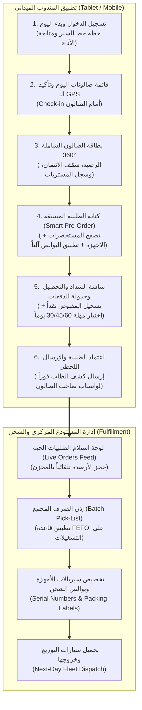
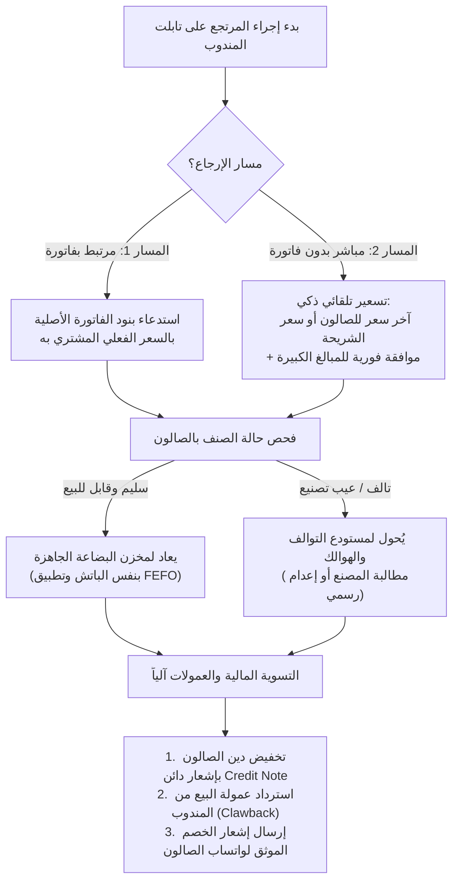
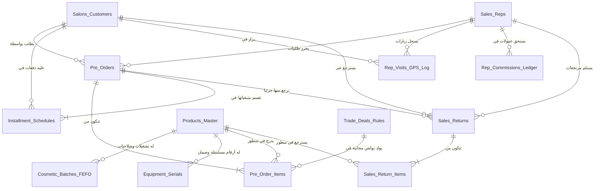
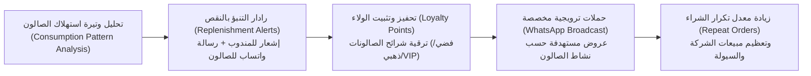
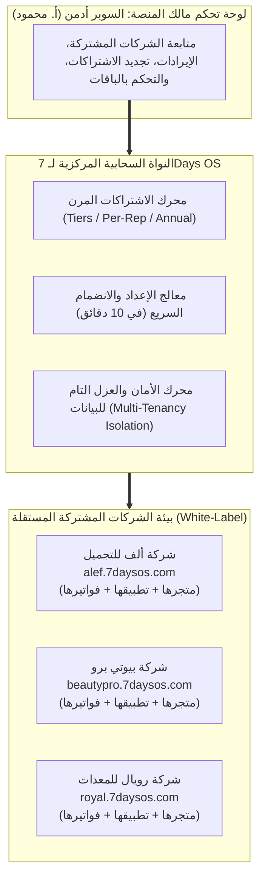

# وثيقة المخطط المعماري والتأسيسي الشامل لمنظومة
# 7Days OS Sales & Marketing

**العميل وصاحب الرؤية والمنشأة:** أ. محمود  
**الجهة المنفذة:** الإدارة الهندسية العليا وفريق تطوير البرمجيات  
**تاريخ الاعتماد الرسمي:** 10 نوفمبر 2026  
**العملة المعتمدة:** الجنيه المصري (EGP)  
**حالة الوثيقة:** معتمدة رسمياً وموثقة بناءً على موافقة العميل  

---

## 1. نبذة المشروع والهدف الاستراتيجي (Executive Summary)

تم إطلاق مشروع **7Days OS Sales & Marketing** ليكون المنظومة البرمجية السحابية المتقدمة والمتخصصة في إدارة وتطوير شركات **مستحضرات التجميل، العناية بالشعر، ولوازم ومعدات الصالونات ومراكز التجميل**.

صُممت المنظومة لتجمع بين الرصانة المحاسبية الدقيقة للأنظمة التجارية الكلاسيكية (المستفادة من تحليل Easy Store ERP)، وبين المرونة الحديثة المطلوبة لمتابعة حركة المبيعات الميدانية، إدارة البوانص، تحفيز المندوبين، وحماية رأس المال والتحصيلات ومنع النزاعات مع أصحاب الصالونات.

---

## 2. نموذج الأعمال وطبيعة النشاط (Business Model)

تعتمد المنشأة نموذج أعمال هجين ومتكامل (Hybrid Model) يضم:
1. **الاستيراد الخارجي:** لعلامات وتوكيلات عالمية متخصصة في التجميل ومعدات الصالونات.
2. **التصنيع والتعبئة لدى الغير (Private Label & Contract Manufacturing):** لإنتاج خطوط إنتاج خاصة بالشركة.
3. **الوكالات والتوزيع التجاري:** شراء منتجات مصانع محلية كبرى وإعادة توزيعها.

---

## 3. هندسة المنتجات والمخزون المزدوج (Dual-Inventory Engine)

نظراً لاختلاف طبيعة المنتجات، يقسم النظام المستودعات والأصناف إلى مسارين برمجين مستقلين ومتكاملين:

### المسار الأول: مستحضرات التجميل والعناية (Cosmetics & Hair Care)
* **الأصناف:** بروتين، كيراتين، شامبوهات، بلسم، صبغات، سيروم، ماسكات، حمامات كريم.
* **آلية التتبع الإلزامية:**
  - تتبع رقم التشغيلة (**Batch / Lot Number**).
  - تتبع تاريخ الإنتاج وتاريخ انتهاء الصلاحية (**Expiry Date**).
  - سياسة صرف المخزون الذكية: ما ينتهي أولاً يُصرف أولاً (**FEFO - First Expired, First Out**).
  - نظام تنبيهات وقائي للإدارة بالمستحضرات المقتربة من انتهاء الصلاحية (قبل 90 و60 و30 يوماً).

### المسار الثاني: أجهزة ومعدات ومستلزمات الصالونات (Salon Equipment & Furniture)
* **الأصناف:** مجففات شعر (سشوار)، مكاوي شعر وتمليس، أجهزة بخار وبديكير، كراسي هيدروليك، ومغاسل صالونات.
* **آلية التتبع الإلزامية:**
  - تتبع الرقم التسلسلي الفريد لكل جهاز (**Unique Serial Number Tracking**).
  - إصدار شهادات الضمان الرقمية للصالون.
  - سجل متابعة الصيانة، الأعطال، وقطع الغيار لكل جهاز تحت الضمان وخارجه.

---

## 4. شرائح العملاء والقنوات البيعية (Customer Segmentation)

يدعم النظام 4 قنوات توزيع رئيسية مع تخصيص الأسعار وشروط الدفع لكل فئة:
1. **الصالونات ومراكز التجميل (B2B Core - صالونات حريمي، صالونات رجالي، مراكز سبا):**
   - خطوط سير دورية، سحب شهري متكرر، وتسهيلات ائتمانية.
2. **تجار الجملة والموزعون بالمحافظات:**
   - كميات تعاقدية كبيرة، أسعار جملة خاصة، وشروط دفع محددة.
3. **الصيدليات ومحلات مستحضرات التجميل:**
   - تسعير تجاري ومطابقة فواتير منتظمة.
4. **المستهلك النهائي المباشر (B2C):**
   - البيع النقدي عبر صالات العرض التابعة للشركة أو عبر المتجر الإلكتروني.

---

## 5. دورة المبيعات الميدانية وتطبيق المندوب والمخزن (Field Sales & Warehouse Workflow)

### 5.1 المخطط الانسيابي لدورة الطلبيات والشحن (End-to-End Workflow)



### 5.2 التفصيل الوظيفي لشاشات تطبيق المندوب (Sales Rep Tablet/App)

#### الشاشة 1: تسجيل الدخول وبدء يوم العمل (Morning Shift Check-in)
* **الوظيفة:** توثيق بداية يوم عمل المندوب وربط الوردية بالنظام.
* **المحتويات:**
  - عرض لوحة تحفيزية للأداء الشهري للمندوب (إجمالي مبيعاته المحققة، إجمالي المبالغ النقدية المحصلة، والعمولة المستحقة حتى اللحظة).
  - زر تفاعلي: **"بدء خط السير اليومي"** لبدء مزامنة وتتبع إحداثيات الحركة.

#### الشاشة 2: خط السير وصالونات اليوم (Daily Route & GPS Check-in)
* **الوظيفة:** توجيه المندوب جغرافياً وضمان عدم تخطي أي عميل مجدول.
* **المحتويات:**
  - قائمة الصالونات المستهدفة اليوم مرتبة جغرافياً (مثلاً: 12 صالون في منطقة محددة).
  - زر **"تسجيل وصول (GPS Check-in)"**؛ يتحقق النظام آلياً من وجود المندوب فعلياً داخل نطاق الصالون (Geofencing) لمنع الزيارات الوهمية والتلاعب في خط السير.

#### الشاشة 3: بطاقة الصالون الشاملة (Salon 360° Profile)
* **الوظيفة:** تسليح المندوب بكافة البيانات المالية والتفضيلية للعميل قبل التفاوض.
* **المحتويات:**
  - اسم الصالون، اسم المسؤول، رقم الهاتف المحمول المفعل للواتساب.
  - فئة العميل وشريحته السعرية (صالون ذهبي، صالون فضي، صالون عادي).
  - الموقف المالي: الرصيد القائم، الفواتير المستحقة، أعمار الديون (أخضر/برتقالي/أحمر)، وسقف الائتمان المتاح.
  - سجل الأصناف الأكثر شراءً ومعدلات السحب الدورية لتسهيل إعادة الطلب (Re-order).

#### الشاشة 4: شاشة كتابة الطلبية الذكية (Smart Pre-Order Screen)
* **الوظيفة:** تسجيل بنود الطلبية بسرعة وسهولة دون أخطاء.
* **المحتويات:**
  - **تبويب مستحضرات التجميل والعناية:** عرض المنتجات، درجات الألوان، والأحجام، مع بيان رصيد المخزن الفعلي المتاح.
  - **محرك البوانص التلقائي (Auto-Deals):** عند وصول الكمية للشرائح الترويجية (مثال: 10 عبوات بروتين)، يُدرج النظام تلقائياً سطر بونص مجاني (2 عبوة سيروم بسعر 0 ج.م) ويُخصم من المخزن وتُحسب تكلفته ضمن بنود الدعاية دون تعديل يدوي من المندوب.
  - **تبويب أجهزة ومعدات الصالونات:** اختيار مجففات الشعر، الكراسي، والأجهزة، مع إشعار آلي بمدة الضمان والتنويه بأن الرقم التسلسلي (Serial Number) سيُربط آلياً عند الشحن.

#### الشاشة 5: شاشة السداد والتحصيل وجدولة الدفعات (Payment & Installments)
* **الوظيفة:** إحكام التعامل المالي ومنع النزاعات قبل خروج الفاتورة.
* **المحتويات:**
  - بيان إجمالي الطلبية الصافي بعد الخصومات والبوانص المعتمدة.
  - خانة **المسدد نقداً فورياً:** تسجيل أي مبالغ نقدية يدفعها الصالون للمندوب كدفعة مقدمة، مع إصدار سند قبض رقمي فوري برقم متسلسل.
  - خانة **المتبقي الآجل وجدول الاستحقاق:** اختيار مهلة السداد (30 يوماً / 45 يوماً / 60 يوماً) وتوليد جدول بتواريخ وأقساط السداد.
  - **صمام أمان الائتمان (Credit Limit Lock):** التحقق التلقائي؛ في حال تجاوز الصالون مهلة الـ 60 يوماً أو سقف الائتمان، يُعلق الحفظ ويُطلب سداد نقدي أو تصريح إداري استثنائي.

#### الشاشة 6: الاعتماد النهائي وتوثيق الواتساب (Order Confirmation & WhatsApp Shield)
* **الوظيفة:** ترحيل الطلبية للمخزن المركزي وتوثيق المستند قانونياً مع العميل.
* **المحتويات:**
  - إرسال الطلبية وحجز الكميات لحظياً في المخزن المركزي لتفادي التعارض.
  - زر تفاعلي فوري: **"إرسال نسخة موثقة عبر الواتساب"**، يُرسل عبره ملخص الطلبية الرسمي المعتمد (الأصناف، المبالغ، والآجال) مباشرة على هاتف صاحب الصالون بصيغة PDF ورسالة نصية موثقة.

---

### 5.3 التفصيل الوظيفي لشاشات المستودع المركزي والشحن (Central Warehouse Dispatch)

#### الشاشة 1: لوحة استلام الطلبيات الحية (Live Orders Feed)
* شاشة تفاعلية في المستودع المركزي تعرض لحظياً تدفق الطلبيات المعتمدة من مناديب المحافظات والمناطق والمتجر الإلكتروني.
* إدارة حالات الطلب: (جديد $\leftarrow$ معتمد ومحجوز $\leftarrow$ قيد الصرف $\leftarrow$ تم التغليف $\leftarrow$ تم التسليم لسيارة الشحن).

#### الشاشة 2: إذن الصرف المجمع وخطة الصرف الذكية (Consolidated Pick-List & FEFO)
* تجميع طلبيات المنطقة المحددة بضغطة زر واحدة لإصدار إذن سحب بضاعة مجمع لمسؤولي المخزن.
* **تطبيق قاعدة FEFO الصارمة:** يوجه النظام عمال المستودع إلى سحب البضاعة من أرقام التشغيلات (**Batches**) الأقرب انتهاءً لتفادي أي خسائر صلاحية في المستحضرات.

#### الشاشة 3: تخصيص سيريالات الأجهزة وبوالص الشحن (Serial Scanning & Packaging)
* مطابقة ومسح باركود الأرقام المسلسلة (**Serial Numbers**) لأجهزة ومعدات الصالونات برقم الفاتورة واسم الصالون، لتفعيل بطاقة الضمان الإلكترونية تلقائياً بمجرد خروج الشحنة.
* طباعة بوليصة شحن باركود لكل طرد تحتوي على بيانات العميل والمبلغ المطلوب تحصيله عند التسليم إن وجد.

#### الشاشة 4: تحميل أسطول التوزيع وكشوف التسليم (Fleet Dispatch & Manifest)
* توزيع الطرود على سيارات الشحن وفق مسارات خطوط السير الجغرافية.
* طباعة واستخراج كشف التسليمات اليومي (Delivery Manifest) لسائقي أسطول الشحن لبدء التسليم صباح اليوم التالي مع إمكانية تحصيل المبالغ النقدية وتأكيد الاستلام.

---

## 6. سياسات الأسعار، البوانص، والعروض الترويجية (Pricing & Deals Engine)

* **مصفوفة التسعير الشريحي (Tiered Pricing):**
  - سعر الصالون الذهبي (سحب عالي) / سعر الصالون العادي.
  - سعر كبار الموزعين / سعر الجملة / سعر المستهلك النهائي.
* **محرك البوانص والهدايا التلقائي (Free Goods & Trade Schemes):**
  - برمجة قواعد ترويجية مرنة (مثال: اشترِ 10 علب كولاجين + 2 علبة سيروم مجاناً).
  - إدراج الصنف المجاني في الفاتورة بسعر 0 ج.م مع خصمه الفعلي من المخزن واحتساب تكلفته بنداً تسويقياً بدقة متناهية.

---

## 7. محرك عمولات المبيعات الثلاثي (Rep Commission Engine)

تحتسب مستحقات المندوب آلياً في نهاية كل دورة مالية وفق المعادلة المعتمدة:

$$\text{مستحقات المندوب} = \text{الراتب الأساسي الثابت} + \text{عمولة حجم المبيعات المنفذة} + \text{عمولة التحصيل النقدي الفعلي}$$

* **الهدف الاستراتيجي:** حث المندوبين على البيع والتحصيل الفعلي في آن واحد لحماية السيولة النقدية للشركة وتجنب تراكم الديون الراكدة.

---

## 8. درع حماية التحصيلات والديون ومنع النزاعات (Anti-Dispute Shield)

تم بناء هذا القسم خصيصاً للقضاء على مشكلات: (تأخر السداد، نسيان المبالغ المتبقية، ونزاعات كشف الحساب):

1. **جدول الأقساط والدفعات المرن:**
   - ربط الفاتورة بمهلة سداد محددة (30 يوماً / 45 يوماً / 60 يوماً) وتقسيم المتبقي إلى دفعات مجدولة بتواريخ واضحة.
2. **شاشة أعمار الديون الذكية (Aging Analysis):**
   - تصنيف الديون لحظياً (أقل من 30 يوماً، من 31-60 يوماً، أكثر من 60 يوماً) مع تنبيهات ملونة لمدير الائتمان ومندوب المنطقة.
3. **كشف الحساب الرقمي الموثق والربط بالواتساب:**
   - إصدار كشف حساب موثق بصيغة PDF يرسل مباشرة على واتساب صاحب الصالون موضحاً كافة الفواتير، الدفعات، أرقام السندات، والرصيد المتبقي بالتاريخ والوقت، مما يغلق باب الجدل والنزاعات نهائياً.
4. **نظام سقف الائتمان الصارم (Credit Limit Lock):**
   - الإيقاف التلقائي لحساب العميل ومنع إصدار أي طلبيات جديدة عند تجاوز مدة الـ 60 يوماً أو تجاوز سقف الدين، ولا يُفتح إلا بقرار استثنائي من الإدارة العليا.

---

## 9. منظومة المرتجعات الذكية وإدارة التوالف (Smart Returns & Quarantine Engine)

صُممت منظومة المرتجعات لإحكام الرقابة التامة على البضاعة العائدة من الصالونات، ومنع تسرب أي مستحضرات معيبة، وحماية الشركة من التلاعب في الأسعار والعمولات.

### 9.1 مسارا الإرجاع المعتمدان (Dual-Return Pathways)



1. **المسار الأول: مرتجع مرتبط برقم فاتورة محددة (Invoice-Linked Return):**
   - استرجاع الفاتورة الأصلية تلقائياً لمنع إرجاع أي كميات بأسعار مخالفة لما دفعه الصالون.
2. **المسار الثاني: مرتجع حر ومباشر بدون فاتورة (Direct Return without Invoice):**
   - **الهدف التجاري:** تيسير استرجاع الأصناف القديمة أو المباعة عبر فترات سابقة مع مناديب آخرين.
   - **ضوابط حماية رأس المال:**
     - التسعير التلقائي: يحدد النظام سعر الإرجاع تلقائياً بناءً على (آخر سعر اشترى به الصالون هذا الصنف من واقع سجله التاريخي) أو (سعر شريحته السعرية المعتمدة حالياً).
     - الصلاحيات: إذا تجاوز المرتجع الحر حداً مالياً معيناً (مثل 1,000 ج.م)، يتطلب موافقة رقمية بنقرة واحدة من مدير المبيعات.
     - التحقق الفني: مطابقة رقم التشغيلة (**Batch No**) للمستحضرات أو مسح السيريال نمبر للأجهزة للتأكد من تبعيتها للشركة.

### 9.2 تصنيف وجهة البضاعة المخزنية (Stock Disposition)
* **المرتجع السليم:** يعود فورياً لمخزن البضاعة الجاهزة ليُعاد بيعه وفق قاعدة الصرف الذكي (**FEFO**).
* **المرتجع التالف / عيب تصنيع:** يُمنع دخوله لمخزن البضاعة الصالحة، ويُقيد في **مستودع التوالف والهوالك (Damaged Quarantine Stock)** للمطالبة بالتعويض من المصنع أو تجهيز محضر إتلاف.

### 9.3 الأثر المالي وتصحيح العمولات (Financial Settlement & Commission Clawback)
* إصدار إشعار دائن (**Credit Note**) يخصم قيمة المرتجع من المديونية القائمة على الصالون، أو يُسجل كرصيد دائن يسحب به مستقبلاً.
* خصم عمولة البيع المقابلة للمرتجع من حساب المندوب آلياً (**Commission Clawback**) لغلق باب المبيعات الصورية.
* إرسال إشعار توثيق فوري بالواتساب لصاحب الصالون بالرصيد الجديد المتبقي بعد خصم المرتجع.

---

## 10. المعمارية البيانية وقاعدة البيانات الذكية (Database Architecture & Core Entities)



### تفصيل الجداول المحورية لقاعدة البيانات:

#### 1. جدول الصالونات والعملاء (`Salons_Customers`)
| الحقل | الوصف والوظيفة |
| :--- | :--- |
| `Salon_ID` | المعرف الرقمي الفريد للعميل (Primary Key). |
| `Salon_Name` | الاسم التجاري للصالون أو مركز التجميل. |
| `Owner_Name` | اسم صاحب الصالون أو المدير المسؤول. |
| `WhatsApp_Number` | رقم الهاتف الرسمي المعتمد لإرسال الفواتير وكشوف الحساب بالواتساب. |
| `GPS_Latitude` & `GPS_Longitude` | إحداثيات الموقع الجغرافي المعتمد على الخريطة (Geofence). |
| `Tier_Price_Level` | فئة السعر (صالون ذهبي، فضي، عادي، جملة). |
| `Credit_Limit` | سقف الائتمان الأقصى المسموح (بالجنيه المصري). |
| `Max_Delay_Days` | مهلة السداد القصوى المسموحة (30، 45، 60 يوماً). |
| `Is_Credit_Locked` | قفل الحساب الآلي ومنع إصدار طلبيات جديدة عند التعثر. |

#### 2. جدول كتالوج المنتجات الرئيسي (`Products_Master`)
| الحقل | الوصف والوظيفة |
| :--- | :--- |
| `Product_ID` & `Barcode` | كود الصنف وباركود المسح السريع. |
| `Product_Name` | اسم المنتج التجاري وسعته / مواصفاته. |
| `Product_Type` | تصنيف الصنف: (`Cosmetic` مستحضر تجميل أو `Equipment` جهاز صالون). |
| `Buy_Cost_EGP` | تكلفة الشراء أو التصنيع بالجنيه لاحتساب صافي الأرباح اللحظي. |
| `Default_Retail_Price` | سعر البيع للمستهلك النهائي. |
| `Salon_Wholesale_Price` | سعر البيع المعتمد للصالونات ومراكز التجميل. |
| `Min_Stock_Alert` | حد الأمان الأدنى للتنبيه بنواقص المخزن. |

#### 3. جداول المخزون المزدوج (Dual-Inventory Engine)
* **جدول تشغيلات وصلاحيات المستحضرات (`Cosmetic_Batches_FEFO`):**
  - `Batch_Number`: رقم التشغيلة المطبوع على العبوة.
  - `Production_Date` & `Expiry_Date`: تاريخ الإنتاج والانتهاء.
  - `Quantity_Available`: الرصيد المتاح من هذه التشغيلة بالمستودع.
  - `FEFO_Priority_Rank`: ترتيب أولوية الصرف الآلي (الأقرب انتهاءً يخرج أولاً).
* **جدول سيريالات وضمان أجهزة الصالونات (`Equipment_Serials_Warranty`):**
  - `Serial_Number`: الرقم التسلسلي الفريد الممسوح من الجهاز.
  - `Sold_To_Salon_ID` & `Invoice_No`: الصالون المشترى ورقم الفاتورة.
  - `Warranty_Months`: فترة الضمان بالأشهر.
  - `Warranty_End_Date`: تاريخ انتهاء الضمان الفعلي.
  - `Maintenance_Log`: سجل الصيانة وقطع الغيار المركبة للجهاز.

#### 4. جدول قواعد البوانص والعروض الترويجية (`Trade_Deals_Rules`)
* `Deal_ID`: كود العرض الترويجي.
* `Buy_Product_ID` & `Buy_Quantity`: الصنف المشروط شراؤه والكمية المطلوبة.
* `Free_Product_ID` & `Free_Quantity`: الصنف الهدية وكميته المجانية.
* `Start_Date` & `End_Date`: فترة سريان العرض.

#### 5. جداول الطلبيات والفواتير (`Pre_Orders` & `Pre_Order_Items`)
* **رأس الطلبية (`Pre_Orders`):** رقم الفاتورة، كود الصالون، كود المندوب، الإجمالي، الخصم، الصافي، المدفوع نقداً، المتبقي الآجل، ومهلة السداد.
* **سطور الطلبية (`Pre_Order_Items`):** كود الصنف، الكمية، السعر، وحقل `Is_Free_Bonus` لتمييز الصنف المجاني (بسعر 0 ج.م)، ورقم التشغيلة المصروفة أو سيريال الجهاز المخصص.

#### 6. جدول جدولة الأقساط والدفعات وأعمار الديون (`Installment_Schedules`)
* `Schedule_ID` & `Order_No` & `Salon_ID`.
* `Due_Date`: تاريخ استحقاق الدفعة باليوم والشهر والسنة.
* `Due_Amount` & `Paid_Amount`: القيمة المستحقة والمسدد منها.
* `Aging_Status`: تصنيف عمر الدين اللحظي:
  - 🟢 أخضر: في حدود المهلة.
  - 🟡 برتقالي: متأخر من 1 إلى 15 يوماً.
  - 🔴 أحمر: متأخر لأكثر من 15 يوماً (تجميد السحب فورياً).

#### 7. جدول فواتير المرتجعات (`Sales_Returns` & `Sales_Return_Items`)
* `Return_ID`: رقم إشعار المرتجع المتسلسل.
* `Invoice_No`: رقم الفاتورة الأصلية (اختياري - يقبل Null في حالة المرتجع المباشر).
* `Return_Type`: نوع المرتجع (`Linked_To_Invoice` أو `Direct_No_Invoice`).
* `Stock_Target`: مستودع الوجهة (`Sellable_Stock` بضاعة صالحة أو `Quarantine_Damaged` توالف).
* `Return_Reason`: سبب الإرجاع (فائض / عيب صناعة / كسر شحن).
* `Net_Credit_Amount`: إجمالي القيمة الدائنة المخصومة من حساب الصالون.
* `Approval_Status`: حالة الاعتماد الإداري في حال تجاوز سقف المبالغ المحددة.

#### 8. جدول عمولات المندوبين الثلاثي (`Rep_Commissions_Ledger`)
* احتساب شهري آلي: الراتب الثابت + عمولة حجم البيع + عمولة التحصيل الفعلي - خصومات عمولات المرتجعات (**Clawbacks**).

#### 9. جدول سجل زيارات المندوبين الجغرافية (`Rep_Visits_GPS_Log`)
* توثيق إحداثيات ومواعيد الوصول والمغادرة والمسافة المترية بين المندوب وباب الصالون ونتيجة كل زيارة لمنع الزيارات الوهمية.

---

## 11. جناح التسويق الذكي وعلاقات الصالونات (Marketing & Salon CRM Engine)

صُمم جناح التسويق لرفع مبيعات الشركة، منع تسرب الصالونات للمنافسين، وإدارة الحملات الترويجية الموجهة بدقة.

### 11.1 المخطط الانسيابي لدورة التسويق والولاء (CRM Pipeline)



### 11.2 المكونات الوظيفية لمحرك التسويق:

#### 1. رادار التنبؤ بنفاد المستحضرات بالصالون (Replenishment Radar)
* **الوظيفة:** دراسة معدل استهلاك وسحب كل صالون تلقائياً للأصناف الحيوية (بروتين، كيراتين، صبغات، شامبوهات).
* **آلية العمل:**
  - إذا كان صالون معين يستهلك عبوة بروتين 1 لتر كل 25 يوماً، يقوم النظام في اليوم الـ 20 بإرسال تنبيه ذكي على تابلت المندوب أثناء زيارته لاقتراح تجديد الطلبية.
  - إرسال رسالة تذكيرية لطيفة وآلية باسم الشركة على واتساب الصالون لتأمين احتياجاتهم قبل النفاد، مما يقطع الطريق على أي شركة منافسة.

#### 2. برنامج ولاء وترقيات الصالونات (Salon Loyalty & Tier Club)
* **نظام النقاط:** احتساب نقاط ولاء تلقائية مع كل سداد نقدي يتم في موعده (مثلاً: 10 نقاط لكل 100 ج.م مسددة).
* **ترقية الفئات:**
  - صالون فضي $\rightarrow$ صالون ذهبي $\rightarrow$ صالون بلاتينيوم (VIP).
* **مكافآت الولاء:** استبدال النقاط بهدايا ترويجية باسم العلامة التجارية (مرايل كوافير، فوط، استاندات عرض للمنتجات) أو خصومات إضافية على أجهزة ومعدات الصالونات، مما يعزز ارتباط الصالون بالشركة ويحفزه على سرعة السداد.

#### 3. حملات الواتساب الترويجية الموجهة (Targeted WhatsApp Broadcast)
* تصنيف الصالونات وإرسال عروض خاصة ومخصصة لكل شريحة:
  - عروض أجهزة الصالونات والمغاسل $\leftarrow$ للمراكز الجديدة أو التي تجري تجديدات.
  - عروض الصبغات ومثبتات الألوان $\leftarrow$ لكوافيرات السيدات المتخصصة في التلوين والتصفيف.
* قياس العائد التسويقي: تتبع عدد الطلبيات الناتجة عن كل حملة ترويجية لحساب فعاليتها بدقة.

---

## 12. لوحة تحكم الإدارة العليا ومؤشرات الأداء اللحظية (Executive Dashboard & Live Cockpit)

شاشة مركزية صُممت خصيصاً للإدارة العليا (أ. محمود) لتفتح من الهاتف المحمول أو شاشة الحاسب المكتبي، لتعطي رؤية شاملة وحية لكافة عمليات الشركة في 60 ثانية:

```
+-------------------------------------------------------------------------------------------------+
|                        لوحة تحكم رئيس مجلس الإدارة (Executive Cockpit)                          |
+-------------------------------------------------------------------------------------------------+
| [💰 مبيعات اليوم اللحظية]  [💵 التحصيلات النقدية اليوم]  [📦 عدد طلبيات اليوم]   [⚠️ ديون متأخرة]  |
|      185,000 ج.م                  72,000 ج.م                    28 طلبية             3 صالونات   |
+-------------------------------------------------------------------------------------------------+
```

### المؤشرات الستة المحورية في لوحة التحكم:

1. **رادار السيولة النقدية والخزائن (Live Cash & Treasury Radar):**
   - الرصيد اللحظي للخزينة المركزية وخزائن الكاشير.
   - النقدية المتواجدة حالياً في عُهد المناديب في الميدان (المبالغ المحصلة كاش اليوم وقيد التوريد).
   - أرصدة الحسابات البنكية ومحافظ الدفع الإلكتروني.
2. **الرقابة الحية على المناديب عبر الخريطة (Live Field Reps & Route Tracking):**
   - خريطة تفاعلية توضح مواقع المناديب في المحافظات والمناطق لحظياً.
   - إحصائيات المندوب الفورية: عدد الصالونات المزارة، عدد الطلبيات المكتوبة، قيمة النقدية المحصلة، والمسافة الجغرافية لنقاط الزيارة.
3. **رادار حماية الديون وأعمارها (Debt Aging Radar):**
   - إجمالي ديون السوق مصنفة بالألوان:
     - 🟢 **أخضر (آمن):** ديون في موعدها الطبيعي (أقل من 30 يوماً).
     - 🟡 **برتقالي (تحذير):** فواتير حان موعد استحقاقها هذا الأسبوع للتوجيه بالتحصيل.
     - 🔴 **أحمر (خطر):** صالونات متعثرة تجاوزت الـ 60 يوماً (تم تجميد حساباتها تلقائياً وتنتظر قرار الإدارة).
4. **رادار المخزون والنواقص والصلاحيات (Inventory & Production Radar):**
   - **تنبيه النواقص:** إشعار بالأصناف المقتربة من حد الطلب لبدء الاستيراد أو التصنيع لدى الغير فوراً.
   - **تنبيه التشغيلات الحرجة:** إشعار بأي تشغيلة مستحضرات متبقٍ على انتهاء صلاحيتها 60 يوماً لتوجيه النظام بإطلاق بونص أو عرض ترويجي فوري لتصريفها وتحصيل قيمتها قبل أي خسارة.
5. **مؤشر صافي الأرباح اللحظي (Net Profit Pulse):**
   - احتساب فوري لأرباح اليوم التشغيلية = (سعر البيع - تكلفة الشراء والتصنيع - تكلفة البوانص المجانية - مصاريف الشحن والعمولات).

---

## 13. المتجر الإلكتروني المدمج وبوابة الطلبات (Integrated E-Commerce Portal)

* **متجر متصل مركزياً:** ربط متجر الويب وتطبيقات الشراء مع نفس قاعدة بيانات المخزون المركزي لتفادي البيع بدون رصيد فعلي.
* **قناتا طلب موحدتان:**
  - **بوابة الصالونات (B2B Portal):** يتيح لأصحاب الصالونات المعتمدين استعراض أسعارهم الخاصة، كشوف حساباتهم، وتأكيد طلبياتهم في أي وقت.
  - **متجر المستهلك النهائي (B2C Store):** للبيع المباشر بالأسعار القطاعية مع الدفع الفوري (كاش عند الاستلام أو محافظ إلكترونية وبطاقات بنكية).

---

## 14. المعمارية السحابية لمنصة SaaS متعددة الشركات (Multi-Tenant SaaS Platform)

تحول نظام **7Days OS** رسمياً بموافقة العميل إلى **منصة سحابية خدمية متعددة الشركات (Multi-Tenant SaaS Platform)** موجهة لخدمة قطاع شركات مستحضرات التجميل والعناية بالشعر ولوازم ومعدات الصالونات، قابلة للتوسع واستيعاب مئات الشركات المشتركة مع عزل وتشفير تام لبيانات كل شركة.

### 14.1 المخطط المعماري لمنصة SaaS (Multi-Tenant Architecture)



### 14.2 الركائز الخمس لمنظومة الـ SaaS:

#### 1. محرك الاشتراكات والتسعير المرن (Flexible Billing Engine)
يمنح مالك المنصة (أ. محمود) كامل المرونة في تحديد طريقة محاسبة كل شركة مشتركة:
* **نظام الباقات الثابتة (Tiered Subscriptions):**
  - **باقة البداية (Starter):** حتى 3 مناديب ومخزن واحد (للأنشطة والشركات الناشئة).
  - **باقة النمو (Pro):** حتى 10 مناديب ومخزنين مع ميزة رسائل الواتساب التلقائية وتتبع الـ GPS.
  - **باقة المؤسسات (Enterprise):** مناديب ومخازن غير محدودة، دعم الفاتورة الإلكترونية، والربط الكامل.
* **نظام الدفع حسب عدد المناديب (Per-User / Per-Rep):**
  - محاسبة شهرية مرنة عن كل تابلت/مندوب نشط في الميدان.
* **الاشتراك السنوي المفتوح:** اشتراك سنوي شامل لكافة المزايا بخصم تشجيعي.

#### 2. الهوية المستقلة لكل مشترك (White-Labeling & Subdomains)
* تمنح المنصة كل شركة مشتركة نطاقاً فرعياً مستقلاً (Subdomain) مثل: `companyname.7daysos.com`.
* **ظهور هوية الشركة المشتركة بالكامل:**
  - شعارها وألوانها على تطبيق التابلت والموبايل للمناديب.
  - اسمها وبياناتها على فواتير المبيعات ورسائل الواتساب المرسلة للصالونات.
  - متجر إلكتروني يحمل علامتها التجارية المستقلة.

#### 3. بوابة مالك المنصة "السوبر أدمن" (Super Admin Portal - شاشة أ. محمود)
لوحة قيادة مركزية عليا مخصصة لمالك المنصة تتيح:
* **مؤشرات أداء الاستثمار:** عدد الشركات المشتركة الفعالة، إجمالي الإيرادات الشهرية والسنوية، ومعدل نمو المشتركين.
* **إدارة الاشتراكات والتجديدات:** تنبيهات بمواعيد انتهاء اشتراكات الشركات، والإيقاف التلقائي للنظام في حال عدم السداد مع إرسال إشعارات تذكيرية.
* **التحكم في الميزات (Feature Flags):** تفعيل أو تعطيل خواص معينة لكل شركة حسب باقتها المعتمدة.

#### 4. معالج الانضمام والتهيئة السريعة (Self-Service 10-Minute Onboarding Wizard)
* واجهة ذاتية ترشد الشركات الجديدة خطوة بخطوة لبدء العمل في 10 دقائق فقط:
  1. إدخال بيانات الشركة ورفع الشعار وهوية الفواتير.
  2. رفع شيت إكسيل العملاء والصالونات مع التنقية الآلية لأرقام الهواتف (+20).
  3. رفع شيت إكسيل المنتجات والأجهزة ومعدات الصالونات وقوائم الأسعار.
  4. اعتماد الحساب وبدء المناديب في كتابة الطلبيات الميدانية فوراً.

#### 5. المتاجر الإلكترونية المتعددة المستقلة (Dedicated Multi-Storefronts)
* يحصل كل مشترك تلقائياً على متجر إلكتروني مستقل وخاص به:
  - **بوابة صالونات B2B:** تتيح لصالونات تلك الشركة فقط استعراض الأسعار وطلب الشحنات.
  - **متجر قطاعي B2C:** لبيع المستحضرات للمستهلك النهائي والدفع الإلكتروني، مع اتصال لحظي بنفس مستودع الشركة المشتركة.

---

## 15. المعمارية التقنية والتكامل المستقبلي (Target Architecture)

* **الواجهات والتطبيقات (Frontend Ecosystem):**
  - لوحة تحكم السوبر أدمن لمالك المنصة (Super Admin Console).
  - لوحات تحكم الشركات المشتركة (Web Tenant Dashboards) للإدارة والمخازن.
  - تطبيق جوال وتابلت للمناديب في الميدان يعمل بنظام Offline-First للمناطق ضعيفة التغطية.
  - متاجر إلكترونية مستقلة ومتوافقة مع الهواتف الذكية لكل مشترك.
* **الامتثال القانوني والضريبي:**
  - جاهزية الربط المباشر مع منظومة الفاتورة والإيصال الإلكتروني لمصلحة الضرائب المصرية (ETA e-Invoicing SDK).

---

## 16. جدول الاعتماد والتوقيع

| الطرف | الصفة | الاعتماد والقرار |
| :--- | :--- | :--- |
| **أ. محمود** | صاحب المنشأة ومالك المنصة | **معتمد وموافق على التوثيق رسمياً كمنصة Multi-Tenant SaaS** |
| **الإدارة الهندسية** | كبير المهندسين ومجلس الإدارة | **تم إثبات البنود واكتمال المرحلة المعمارية السحابية بنجاح** |

| الطرف | الصفة | الاعتماد والقرار |
| :--- | :--- | :--- |
| **أ. محمود** | صاحب المنشأة والقرار | **معتمد وموافق على التوثيق رسمياً** |
| **الإدارة الهندسية** | كبير المهندسين ومجلس الإدارة | **تم إثبات البنود واكتمال مرحلة التخطيط التفصيلي بنجاح** |
