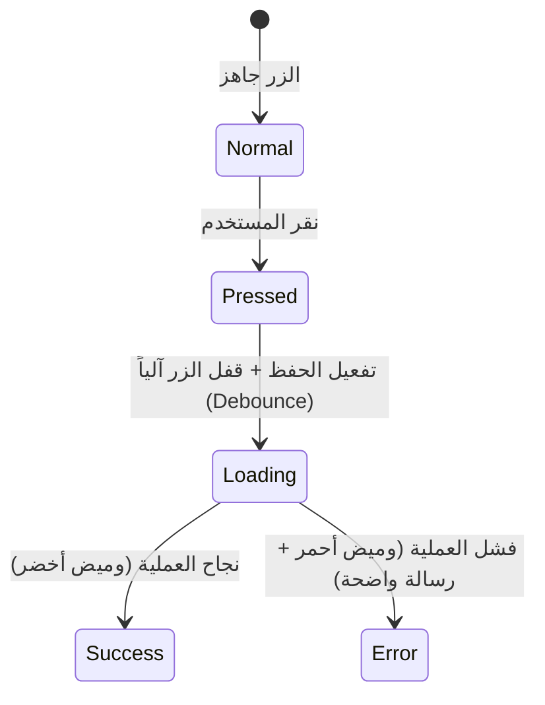

# دليل نظام التصميم والهوية المرئية الموحدة
# 7Days OS Design System & Visual Guidelines

**المشروع:** منصة 7Days OS Sales & Marketing (SaaS)  
**العميل ومالك المنصة:** أ. محمود  
**الجهة المنفذة:** الإدارة الهندسية المركزية وفريق تصميم واجهات وتجربة المستخدم (UI/UX)  
**تاريخ الاعتماد الرسمي:** 10 نوفمبر 2026  
**المسار المعتمد:** `H:\7DAYS OS\docs\01_Design_System_And_Visual_Identity.md`  
**حالة الوثيقة:** معتمدة رسمياً وموثقة بناءً على موافقة العميل الصريحة  

---

## 1. الفلسفة البصرية والهدف الهندسي (Design Philosophy)

صُمم نظام التصميم لمنصة **7Days OS** ليحقق توازناً دقيقاً بين ثلاثة أركان:
1. **الفخامة والأناقة:** بما يليق بقطاع مستحضرات التجميل، العناية بالشعر، ولوازم ومعدات الصالونات ومراكز التجميل.
2. **الوضوح والتباين العالي (High Contrast & Daylight Readability):** لضمان قراءة سريعة ومريحة لبيانات الفواتير والأسعار على شاشات الهواتف المحمولة والتابلت تحت إضاءة الشمس المباشرة أو إضاءة الصالونات القوية.
3. **الحيادية التقنية ومنع هلوسة الذكاء الاصطناعي (AI Consistency Contract):** وضع معايير أكواد ألوان وخطوط وأبعاد أزرار قطعية لا يجوز لأي نموذج ذكاء اصطناعي أو مبرمج تجاوزها أو استبدالها.

---

## 2. التوافق العتادي والتجاوب الذكي (Device Agnostic & Responsive)

* **القاعدة الهندسية الأساسية:** **لا يُشترط تابلت إطلاقاً**؛ النظام يعمل بكفاءة تامة 100% على:
  - **الهواتف الذكية (Smartphones):** أي هاتف شخصي للمندوب (Android أو iOS) عبر تصميم عمودي مريح لليد الواحدة.
  - **الأجهزة اللوحية (Tablets / iPads):** شاشات عريضة تتسع لجداول المنتجات الكبيرة وعروض الصالونات.
  - **الحواسيب المكتبية والمحمولة (Laptops / Desktops):** لوحة تحكم السوبر أدمن، إدارة المخازن، والحسابات.

---

## 3. لوحة الألوان المعتمدة (Color Palette Specifications)

```
+-------------------------------------------------------------------------------------------------+
|                                 لوحة الألوان المعتمدة لـ 7Days OS                               |
+-------------------------------------------------------------------------------------------------+
| [👑 الكحلي الملكي #0F172A]  [✨ ذهبي الصالونات #D4AF37]  [🟢 أخضر السداد #10B981]  [🔴 أحمر الخطر #EF4444] |
|        اللون الأساسي                   اللمسات الترويجية              الطلبات المعتمدة           تجميد الديون     |
+-------------------------------------------------------------------------------------------------+
```

### 3.1 الألوان الأساسية للعلامة والهوية (Core Brand Colors)
| اللون | كود الـ HEX | RGB | الاستخدام البرمجي |
| :--- | :--- | :--- | :--- |
| **الكحلي الملكي العميق (Royal Deep Navy)** | `#0F172A` | `15, 23, 42` | خلفية القوائم العلوية، الأزرار الأساسية (Primary Buttons)، والعناوين الرئيسية. |
| **الكحلي الوسيط (Slate Surface)** | `#1E293B` | `30, 41, 59` | القوائم الجانبية (Sidebar) والخلفيات الداكنة للبطاقات. |
| **ذهبي الصالونات التجميلي (Salon Champagne Gold)**| `#D4AF37` | `212, 175, 55`| تمييز الصالونات الذهبية (VIP)، شارات البوانص، وأيقونات التميز. |
| **الرمادي الفاتح المريح (Canvas Light)** | `#F8FAFC` | `248, 250, 252`| خلفية الشاشات وجداول الأصناف لمنع إجهاد العين والحفاظ على البطارية. |
| **الأبيض النقي (Pure Card White)** | `#FFFFFF` | `255, 255, 255`| خلفيات بطاقات الصالونات، حقول الإدخال، وبنود الفواتير. |

### 3.2 ألوان الإشارات الوظيفية والأمان (Semantic Status Colors)
| الإشارة والوظيفة | كود الـ HEX | المعنى التشغيلي في النظام |
| :--- | :--- | :--- |
| 🟢 **أخضر الإنجاز والائتمان (Emerald Success)** | `#10B981` | الصالون مسدد بانتظام، الفاتورة معتمدة، سطور البوانص المجانية (0 ج.م)، وزر إرسال الواتساب. |
| 🟡 **كهرماني التحذير والمهل (Amber Warning)** | `#F59E0B` | فواتير مستحقة السداد هذا الأسبوع (30/45 يوماً)، وتشغيلات قاربت على انتهاء الصلاحية خلال 60 يوماً. |
| 🔴 **أحمر الخطر والتجميد (Crimson Danger)** | `#EF4444` | الصالونات المتعثرة (>60 يوماً وتجميد السحب)، التشغيلات منتهية الصلاحية، ومستودع التوالف. |
| 🔵 **أزرق الملاحة والـ GPS (Navigation Blue)** | `#2563EB` | زر تسجيل وصول المندوب (Check-in)، مسارات الخريطة، وأزرار المساعدة. |

---

## 4. الخطوط والطباعة الرقمية (Typography Hierarchy)

* **الخط العربي واللاتيني الرسمي:** خط **`Cairo`** كخط أساسي، وخط **`IBM Plex Sans Arabic`** كخط بديل.
* **الخط الرقمي الأحادي (Monospace):** خط **`JetBrains Mono`** أو خط النظام الرقمي للأرقام التسلسلية (Serials)، أرقام التشغيلات (Batches)، وأكواد الباركود الدولية لمنع التداخل والخلط البصري.

### مقاسات وأوزان الخطوط القياسية:
| المستوى | المقاس على الموبايل | المقاس على الشاشات الكبيرة | الوزن (Weight) | الاستخدام |
| :--- | :--- | :--- | :--- | :--- |
| **عنوان الشاشة (Header 1)** | `22px` | `28px` | `Bold (700)` | عنوان الشاشة الحالي (مثل: "طلبية صالون الملكة"). |
| **عنوان فرعي (Header 2)** | `18px` | `20px` | `Semi-Bold (600)`| عناوين التبويبات والمجموعات (مستحضرات / أجهزة). |
| **المبالغ المالية البارزة (Financial Metric)** | `24px` | `32px` | `Bold (800)` | إجمالي الفاتورة، الرصيد المتبقي، ومبالغ الخزينة. |
| **النصوص العادية (Body Text)** | `15px` | `16px` | `Regular (400)` | أسماء الأصناف، العناوين، وشرح سندات القبض. |
| **التنبيهات والملاحظات (Micro/Caption)** | `12px` | `13px` | `Medium (500)` | تواريخ الاستحقاق، أرقام السجلات، وتنبيهات الـ GPS. |

---

## 5. هندسة الأزرار وشاشات اللمس (Touch Ergonomics & Buttons)

صُممت الأزرار خصيصاً لتناسب حركة أصابع اليد على شاشات الموبايل والتابلت:
* **منطقة اللمس الآمنة (Minimum Touch Target):**  
  الحد الأدنى لارتفاع أي زر تفاعلي هو **48 بكسل (48px)** لضمان نقرة سريعة دون أخطاء أثناء وقوف المندوب بالصالون.
* **انحناء الزوايا (Border Radius):**  
  مقاس ثابت **`8px` إلى `10px`** لإضفاء لمسة عصرية ناعمة.

### حالات وسلوك الأزرار التفاعلية:


1. **الزر الأساسي (Primary):** خلفية كحلي ملكي `#0F172A` بنص أبيض ناصع (لتأكيد الطلب وحفظ الفاتورة).
2. **الزر الإيجابي / الواتساب (Action Positive):** خلفية خضراء `#10B981` بنص أبيض (لإرسال كشف الواتساب وسند القبض).
3. **الزر التحذيري / الحذف (Danger Action):** خلفية حمراء `#EF4444` (لإلغاء بند أو تأكيد مرتجع تالف).
4. **حالة منع النقر المزدوج (Anti-Double Click Shield):**  
   بمجرد النقر على زر "حفظ الطلب"، يتحول الزر فورياً إلى مؤشر تحميل (Spinner) ويُعطل لمدة 3 ثوانٍ لمنع تكرار إنشاء الفاتورة مرتين في حال بطء شبكة المحمول.

---

## 6. بطاقات الصالونات وقوائم البيانات (Cards & Lists UI)

* **بطاقة الصالون الموحدة (Salon Profile Card):**
  - تظهر كبطاقة بيضاء ناصعة محاطة بإطار رمادي ناعم (`#E2E8F0`).
  - **شريط مؤشر الائتمان على الجانب الأيمن (Credit Status Strip):**
    * 🟢 شريط أخضر بعرض 6px: صالون سليم ملتزم لا توجد عليه متأخرات.
    * 🟡 شريط أصفر بعرض 6px: صالون لديه دفعة مستحقة خلال هذا الأسبوع.
    * 🔴 شريط أحمر بعرض 6px: صالون مجمد ائتمانياً لتجاوزه مهلة الـ 60 يوماً.
  - أزرار الوصول السريع داخل البطاقة:
    * زر الاتصال الهاتفي السريع 📞 بنقرة واحدة.
    * زر فتح محادثة الواتساب الرسمية 💬 بنقرة واحدة.

---

## 7. جدول الاعتماد والتوقيع

| الطرف | الصفة | الاعتماد والقرار |
| :--- | :--- | :--- |
| **أ. محمود** | صاحب المنشأة ومالك المنصة | **معتمد وموافق على نظام التصميم رسمياً** |
| **الإدارة الهندسية** | كبير المهندسين ومجلس الإدارة | **تم إثبات مواصفات الهوية والبدء في كتالوج الشاشات** |
