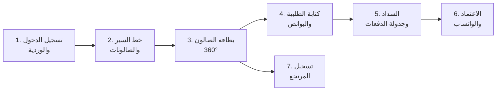

# كتالوج تفصيل الشاشات الوظيفية الشامل (Screen-by-Screen Functional Specifications)
# 7Days OS Sales & Marketing Platform

**المشروع:** منصة 7Days OS Sales & Marketing (SaaS)  
**العميل ومالك المنصة:** أ. محمود  
**الجهة المنفذة:** الإدارة الهندسية المركزية وفريق تصميم واجهات وتجربة المستخدم (UI/UX)  
**تاريخ الاعتماد الرسمي:** 10 نوفمبر 2026  
**المسار المعتمد:** `H:\7DAYS OS\docs\02_Screen_By_Screen_Functional_Specs.md`  
**حالة الوثيقة:** معتمدة رسمياً وموثقة بناءً على موافقة العميل الصريحة  

---

## 1. مبدأ التوثيق والضمانات الهندسية (Documentation Principles)

> [!IMPORTANT]
> هذه الوثيقة هي **العقد البرمجي الملزم** لكل مبرمج ونموذج ذكاء اصطناعي يشارك في بناء المنصة. لا يجوز لأي طرف إضافة حقل أو زر أو رسالة تنبيه لم يرد في هذه الوثيقة دون موافقة خطية صريحة من أ. محمود أو الإدارة الهندسية المركزية.

> [!NOTE]
> يعمل النظام بكفاءة 100% من أي هاتف ذكي شخصي للمندوب (Android / iOS) دون اشتراط شراء تابلت خاص، كما يعمل على التابلت والحواسيب المكتبية بفضل تصميم التجاوب الذكي (Responsive Design).

---

## 2. المجموعة الأولى: شاشات تطبيق المندوب الميداني (Field Rep Mobile App)

### خريطة رحلة شاشات المندوب الـ 7 (Rep Screen Journey Map)



---

### الشاشة 1: تسجيل الدخول وبدء اليوم (Login & Daily Shift Check-in)

**الهدف الوظيفي:** توثيق حضور المندوب، ربط الوردية بالنظام، وعرض لوحة تحفيزية لأداءه الشهري.

#### 1.1 تخطيط الشاشة (Wireframe Layout)
```
+-----------------------------------------------+
|               7Days OS Sales                  |
|          [شعار شركة العميل المشتركة]          |
|                                               |
|  رقم الهاتف:     [ 010xxxxxxxx              ]  |
|  كلمة المرور:    [ •••••••••        👁️      ]  |
|                                               |
|  [     تسجيل الدخول وبدء خط السير اليومي     ] |
|                                               |
| ───────────────────────────────────────────── |
|  📊 ملخص أداءك لهذا الشهر:                   |
|  - مبيعاتك المحققة: 145,000 ج.م               |
|  - تحصيلاتك النقدية: 68,000 ج.م               |
|  - عمولتك المستحقة حتى الآن: 4,850 ج.م 💰    |
+-----------------------------------------------+
```

#### 1.2 مواصفات حقول الإدخال (Input Fields)
| الحقل | النوع | إجباري؟ | التحقق والقواعد |
| :--- | :--- | :--- | :--- |
| `رقم الهاتف` | `tel` - أرقام فقط | ✅ نعم | 11 رقماً فقط، يبدأ بـ 010 أو 011 أو 012 أو 015. |
| `كلمة المرور` | `password` مشفر | ✅ نعم | حد أدنى 6 أحرف، مع زر إظهار/إخفاء 👁️. |

#### 1.3 الأزرار والأحداث (Buttons & Actions)
| الزر | اللون | الارتفاع | الحدث عند النقر |
| :--- | :--- | :--- | :--- |
| **"تسجيل الدخول وبدء خط السير اليومي"** | كحلي ملكي `#0F172A` | 50px | التحقق من البيانات، وعند النجاح طلب إذن الموقع الجغرافي (GPS)، ثم الانتقال لشاشة 2. |

#### 1.4 رسائل الخطأ والتنبيهات (Error & Alert Messages)
| الحالة | الرسالة التي تظهر للمستخدم | لون الرسالة |
| :--- | :--- | :--- |
| بيانات دخول خاطئة | *"بيانات الدخول غير صحيحة، يرجى مراجعة الإدارة"* | 🔴 أحمر `#EF4444` |
| الحقول فارغة | *"يرجى إدخال رقم الهاتف وكلمة المرور"* | 🟡 كهرماني `#F59E0B` |
| لا يوجد إنترنت | *"لا يوجد اتصال بالإنترنت، تحقق من شبكتك وأعد المحاولة"* | 🔴 أحمر `#EF4444` |
| رفض إذن الـ GPS | *"نظام التتبع يتطلب إذن الموقع لمتابعة خط سيرك - يرجى السماح"* | 🟡 كهرماني `#F59E0B` |

---

### الشاشة 2: خط السير وصالونات اليوم (Daily Salon Route & GPS)

**الهدف الوظيفي:** توجيه المندوب جغرافياً لصالونات اليوم، وضمان تسجيل الحضور الحقيقي أمام كل صالون.

#### 2.1 تخطيط الشاشة (Wireframe Layout)
```
+-----------------------------------------------+
|  📍 صالونات اليوم (منطقة: مدينة نصر) - 12 صالون|
|  [🔍 ابحث باسم الصالون أو الكوافير...]        |
| ───────────────────────────────────────────── |
|  ▌ [بطاقة صالون 1 - شريط أيمن أخضر]           |
|  🟢 بيوتي سنتر الملكة - مدام سوزان             |
|  العنوان: 15 شارع عباس العقاد                 |
|  المتبقي: 4,500 ج.م · الحالة: ملتزم ✅         |
|  [ 📍 تسجيل وصول ]  [ 📞 اتصال ]  [ 💬 واتساب ] |
| ───────────────────────────────────────────── |
|  ▌ [بطاقة صالون 2 - شريط أيمن أحمر]           |
|  🔴 صالون البرنسيسة - كوافير هاني              |
|  العنوان: 42 شارع الطيران                     |
|  المتبقي: 18,000 ج.م · ⚠️ متأخر 52 يوماً      |
|  [ 📍 تسجيل وصول ]  [ 📞 اتصال ]  [ 💬 واتساب ] |
+-----------------------------------------------+
```

#### 2.2 مواصفات حقول الإدخال (Input Fields)
| الحقل | النوع | قاعدة البحث |
| :--- | :--- | :--- |
| `شريط البحث` | `text` | بحث ذكي يتجاهل الهمزات (أ، إ، ا) والياء (ي، ى) ويظهر نتائج لحظية من الحرف الأول. |

#### 2.3 الأزرار والأحداث (Buttons & Actions)
| الزر | اللون | الحدث عند النقر |
| :--- | :--- | :--- |
| **"📍 تسجيل وصول (GPS Check-in)"** | أزرق `#2563EB` | قياس المسافة بين المندوب وموقع الصالون، وتطبيق قواعد القبول أو الرفض أدناه. |
| **"📞 اتصال"** | رمادي فاتح | فتح شاشة الاتصال المباشر برقم هاتف صاحب الصالون. |
| **"💬 واتساب"** | أخضر `#10B981` | فتح محادثة واتساب مباشرة مع صاحب الصالون. |

#### 2.4 قواعد الـ GPS والتحقق من التواجد (Geofencing Rules)
| المسافة بين المندوب والصالون | الحدث التلقائي للنظام |
| :--- | :--- |
| **أقل من 100 متر** | ✅ وميض أخضر: *"تم تسجيل الوصول بنجاح الساعة 10:34 ص"* ← يفتح شاشة 3. |
| **من 100 متر إلى 500 متر** | 🟡 تحذير: *"أنت قريب من الصالون لكن خارج النطاق المعتمد. هل وصلت فعلاً؟"* مع زري (نعم بسبب ضيق الشارع / لا لم أصل بعد). |
| **أكثر من 500 متر** | 🔴 رفض: *"أنت على بعد 1.2 كم من الصالون. تسجيل الوصول يتطلب وجودك أمام الصالون فعلاً."* |

---

### الشاشة 3: بطاقة الصالون الشاملة 360° (Salon 360° Profile)

**الهدف الوظيفي:** تسليح المندوب بكامل البيانات المالية والتفضيلية لصاحب الصالون قبل البدء في التفاوض.

#### 3.1 تخطيط الشاشة (Wireframe Layout)
```
+-----------------------------------------------+
|  ⬅️ بيوتي سنتر الملكة (صالون ذهبي VIP ✨)       |
| ───────────────────────────────────────────── |
|  💳 الموقف الائتماني:                          |
|  الرصيد القائم: 4,500 ج.م                     |
|  سقف الائتمان المتاح: 20,500 ج.م / 25,000 ج.م |
|  أقصى مهلة سداد: 45 يوماً                     |
|  أعمار الديون: 🟢 (كل فواتيره ضمن المهلة)      |
| ───────────────────────────────────────────── |
|  ⭐ أكثر 3 أصناف طلباً لدى هذا الصالون:        |
|  1. بروتين كولاجين برازيلي 1 لتر              |
|  2. سيروم أرجان إيطالي 100 مل                |
|  3. صبغة لاكمي رقم 7.1                       |
| ───────────────────────────────────────────── |
|  [ ➕ إنشاء طلبية جديدة    ]                  |
|  [ 💵 تسجيل سند قبض نقدية  ]                  |
|  [ 🔄 تسجيل مرتجع          ]                  |
|  [ 📄 عرض كشف الحساب كامل  ]                  |
+-----------------------------------------------+
```

#### 3.2 الأزرار والأحداث (Buttons & Actions)
| الزر | اللون | الحدث عند النقر |
| :--- | :--- | :--- |
| **"➕ إنشاء طلبية جديدة"** | كحلي `#0F172A` | الانتقال لشاشة 4 (كتابة الطلبية). |
| **"💵 تسجيل سند قبض نقدية"** | أخضر `#10B981` | فتح نموذج سريع لتسجيل مبلغ نقدي مقبوض من الصالون بدون طلبية جديدة. |
| **"🔄 تسجيل مرتجع"** | كهرماني `#F59E0B` | الانتقال لشاشة 7 (تسجيل المرتجع). |
| **"📄 عرض كشف الحساب كامل"** | رمادي فاتح | فتح شاشة قائمة بكل حركات الصالون المالية مرتبة زمنياً. |

---

### الشاشة 4: كتابة الطلبية الذكية والبوانص (Smart Pre-Order Screen)

**الهدف الوظيفي:** اختيار الأصناف والكميات بسرعة مع التطبيق الآلي للبوانص والتحقق اللحظي من رصيد المستودع.

#### 4.1 تخطيط الشاشة (Wireframe Layout)
```
+-----------------------------------------------+
|  طلب جديد: بيوتي سنتر الملكة                 |
|  [تبويب: 🧴 مستحضرات] | [تبويب: ⚙️ أجهزة]    |
| ───────────────────────────────────────────── |
|  [🔍 ابحث عن صنف بالاسم أو الباركود...]      |
| ───────────────────────────────────────────── |
|  الصنف: بروتين كولاجين برازيلي 1 لتر         |
|  المتاح بالمستودع: 142 عبوة                  |
|  السعر لهذا الصالون (ذهبي): 1,200 ج.م        |
|  الكمية:  [ ➖ ]  [ 10 ]  [ ➕ ]             |
|  إجمالي البند: 12,000 ج.م                    |
| ───────────────────────────────────────────── |
|  🎁 عرض ترويجي مطبق تلقائياً:               |
|  🟢 + 2 سيروم أرجان 100مل مجاناً (0 ج.م)     |
| ───────────────────────────────────────────── |
|  ملخص الطلبية:                               |
|  - أصناف مباعة: 10 عبوات بروتين             |
|  - هدايا بوانص: 2 سيروم (تكلفة ترويجية)     |
|  - صافي المبلغ المستحق: 12,000 ج.م          |
|                                               |
|  [      الانتقال لخيارات السداد ⬅️           ] |
+-----------------------------------------------+
```

#### 4.2 قواعد البوانص التلقائية (Auto-Deal Trigger Rules)
| الشرط | الحدث التلقائي |
| :--- | :--- |
| وصول الكمية للحد المشروط في `Trade_Deals_Rules` | يظهر سطر بونص أخضر مجاني (سعر 0 ج.م) دون أي تدخل يدوي من المندوب. |
| الكمية أقل من الحد المشروط | لا يظهر سطر البونص مطلقاً. |
| انتهاء تاريخ العرض الترويجي | لا يظهر البونص حتى لو تحققت الكمية. |

#### 4.3 رسائل التحقق من المخزون
| الحالة | الرسالة |
| :--- | :--- |
| الكمية المطلوبة أكبر من رصيد المستودع | 🔴 *"الرصيد المتاح 142 عبوة فقط، لا يمكن طلب أكثر من ذلك"* |
| الصنف غير متوفر نهائياً | 🔴 *"هذا الصنف نفد من المستودع المركزي، تواصل مع مدير المخزن"* |

---

### الشاشة 5: السداد وجدولة الدفعات (Payment Terms & Installments)

**الهدف الوظيفي:** تسجيل المبلغ المقبوض نقداً، وجدولة المتبقي الآجل بمهل محددة، وتطبيق صمام أمان سقف الائتمان.

#### 5.1 تخطيط الشاشة (Wireframe Layout)
```
+-----------------------------------------------+
|  💳 سداد طلبية رقم (جارٍ الإنشاء)            |
|  صافي الطلبية: 12,000 ج.م                    |
| ───────────────────────────────────────────── |
|  💵 المدفوع نقداً الآن للمندوب:               |
|  [ 4,000                              ] ج.م   |
|                                               |
|  المتبقي الآجل: 8,000 ج.م                    |
|                                               |
|  ⏱️ مهلة سداد المتبقي:                       |
|  ( ) خلال 30 يوماً                           |
|  (🔘) خلال 45 يوماً                           |
|  ( ) خلال 60 يوماً                           |
| ───────────────────────────────────────────── |
|  📅 جدول الدفعات المولّد تلقائياً:            |
|  - الدفعة 1: 4,000 ج.م · تستحق 25/11/2026   |
|  - الدفعة 2: 4,000 ج.م · تستحق 25/12/2026   |
| ───────────────────────────────────────────── |
|  🛡️ فحص الائتمان: 🟢 سليم ضمن السقف          |
|                                               |
|  [        حفظ واعتماد الطلبية 💾             ] |
+-----------------------------------------------+
```

#### 5.2 قواعد صمام أمان الائتمان (Credit Limit Lock Logic)
| الحالة | الحدث التلقائي |
| :--- | :--- |
| **رصيد الصالون + المتبقي الجديد ≤ سقف الائتمان** | 🟢 يُعتمد تلقائياً وزر الحفظ نشط. |
| **رصيد الصالون + المتبقي الجديد > سقف الائتمان** | 🔴 تعطيل زر الحفظ وإظهار: *"تنبيه: سيتجاوز الصالون سقف الائتمان بـ X ج.م! يرجى زيادة المبلغ النقدي أو طلب استثناء إداري."* |
| **الصالون متأخر أكثر من 60 يوماً (حساب مجمد)** | 🔴 رفض كامل وإظهار: *"حساب هذا الصالون مجمد لتجاوزه مهلة السداد. لا يمكن إصدار طلبيات جديدة إلا بعد موافقة الإدارة."* |

---

### الشاشة 6: الاعتماد النهائي وتوثيق الواتساب (Order Confirmation & WhatsApp Shield)

**الهدف الوظيفي:** حجز الكميات في المستودع المركزي فوراً، وإرسال مستند الطلبية الموثق لصاحب الصالون.

#### 6.1 تخطيط الشاشة (Wireframe Layout)
```
+-----------------------------------------------+
|  ✅ تم اعتماد وحجز الطلبية رقم #ORD-84021    |
| ───────────────────────────────────────────── |
|  العميل: بيوتي سنتر الملكة                   |
|  صافي الطلبية: 12,000 ج.م                    |
|  المسدد كاش: 4,000 ج.م (إيصال #REC-1041)     |
|  المتبقي الآجل: 8,000 ج.م (دفعتان · 45 يوماً)|
|  حالة المستودع: ✅ تم حجز الكميات للشحن الغد   |
| ───────────────────────────────────────────── |
|  [ 💬 إرسال كشف الطلبية على واتساب العميل   ]  |
|  [ 🏠 العودة لخط السير وصالونات اليوم        ] |
+-----------------------------------------------+
```

#### 6.2 آلية زر إرسال الواتساب (WhatsApp Dispatch Logic)
| الخطوة | التفصيل الهندسي |
| :--- | :--- |
| **الضغط على زر الواتساب الأخضر** | يفتح تطبيق واتساب على هاتف المندوب مباشرة على محادثة صاحب الصالون. |
| **محتوى الرسالة المُعدّة آلياً** | رسالة رسمية منسقة تتضمن: (شعار الشركة، رقم الطلبية، الأصناف والكميات، المسدد نقداً، المتبقي، وجدول تواريخ الدفعات القادمة). |
| **صيغة رسالة الواتساب المُرسلة** | PDF مرفق + رسالة نصية ملخصة (نص يقرأه صاحب الصالون فوراً حتى لو لم يفتح الـ PDF). |

---

### الشاشة 7: تسجيل المرتجع (Sales Return - بفاتورة وبدون فاتورة)

**الهدف الوظيفي:** استرجاع البضاعة بمساريها (مرتبط بفاتورة أو حر مباشر)، مع تصنيف السليم والتالف وتسوية حساب الصالون.

#### 7.1 تخطيط الشاشة (Wireframe Layout)
```
+-----------------------------------------------+
|  🔄 تسجيل مرتجع: بيوتي سنتر الملكة           |
| ───────────────────────────────────────────── |
|  طريقة الإرجاع:                              |
|  ( ) مرتجع مرتبط بفاتورة سابقة (اختر رقمها)  |
|  (🔘) مرتجع حر مباشر (بدون فاتورة)           |
| ───────────────────────────────────────────── |
|  الصنف المرتجع: [🔍 ابحث أو امسح الباركود...] |
|                                               |
|  حالة الصنف المرتجع:                         |
|  (🔘) سليم وقابل لإعادة البيع                |
|  ( ) تالف / عيب صناعة (يُحول للتوالف)       |
|                                               |
|  الكمية المرتجعة: [ ➖ ]  [ 3 ]  [ ➕ ]       |
|  السعر المقترح آلياً: 250 ج.م (آخر سعر بيع)  |
|  إجمالي قيمة المرتجع: 750 ج.م               |
|                                               |
|  سبب الإرجاع:                                |
|  [🔘] فائض عن الحاجة                         |
|  [ ] عيب صناعة أو تسريب                      |
|  [ ] كسر أثناء الشحن                         |
|  [ ] تاريخ صلاحية قريب                       |
| ───────────────────────────────────────────── |
|  💰 الأثر المالي:                            |
|  سيتم خصم 750 ج.م من رصيد الصالون           |
|  الرصيد الجديد بعد المرتجع: 3,750 ج.م        |
|                                               |
|  [        تأكيد وحفظ المرتجع 🔄              ] |
+-----------------------------------------------+
```

#### 7.2 قواعد المسارين والتحقق (Dual-Path Return Rules)
| نوع المرتجع | قاعدة التسعير | قاعدة الاعتماد |
| :--- | :--- | :--- |
| **مرتجع مرتبط بفاتورة** | سعر الإرجاع هو سعر البيع الأصلي في الفاتورة بدون تعديل. | يُعتمد تلقائياً بأي قيمة. |
| **مرتجع حر بدون فاتورة (قيمة ≤ حد معتمد)** | سعر الإرجاع هو آخر سعر بيع للصالون لهذا الصنف تاريخياً. | يُعتمد تلقائياً بدون موافقة إدارية. |
| **مرتجع حر بدون فاتورة (قيمة > حد معتمد)** | سعر الإرجاع هو آخر سعر بيع تاريخياً. | 🟡 يُعلّق ويرسل إشعاراً لمدير المبيعات للموافقة بنقرة واحدة. |

#### 7.3 الأثر المحاسبي والمخزني التلقائي (Automated Financial & Stock Impact)
| حالة المرتجع | الحدث التلقائي في النظام |
| :--- | :--- |
| **مرتجع سليم** | إعادة الكميات لمخزن البضاعة الجاهزة بنفس رقم التشغيلة (Batch) وفق قاعدة FEFO. |
| **مرتجع تالف** | نقل الكميات لمستودع التوالف والهوالك (Quarantine) ومنع دخولها للمخزن السليم. |
| **التسوية المالية** | خصم قيمة المرتجع من رصيد الصالون (Credit Note)، أو إضافتها كرصيد دائن يُخصم من أول طلبية. |
| **تصحيح عمولة المندوب** | خصم عمولة البيع المقابلة للمرتجع آلياً من حساب المندوب (Commission Clawback). |
| **إشعار الواتساب** | إرسال رسالة تلقائية لصاحب الصالون: *(تم استلام المرتجع بقيمة 750 ج.م، رصيدك الجديد 3,750 ج.م)*. |

---

## 3. سجل القرارات والتعديلات المعتمدة (Decision Log)

| التاريخ | القرار أو التعديل | معتمد من |
| :--- | :--- | :--- |
| 10/11/2026 | الشاشات السبع لتطبيق المندوب معتمدة رسمياً بكافة حقولها وأزرارها ورسائل الخطأ | أ. محمود |
| 10/11/2026 | قبول المرتجع الحر بدون فاتورة مع التسعير التلقائي بناءً على آخر سعر تاريخي | أ. محمود |
| 10/11/2026 | التطبيق يعمل من أي هاتف شخصي (Android / iOS) دون اشتراط تابلت | أ. محمود |

---

## 4. جدول الاعتماد والتوقيع

| الطرف | الصفة | الاعتماد والقرار |
| :--- | :--- | :--- |
| **أ. محمود** | صاحب المنشأة ومالك المنصة | **معتمد وموافق على شاشات المندوب الميداني الـ 7 رسمياً** |
| **الإدارة الهندسية** | كبير المهندسين ومجلس الإدارة | **تم إثبات المواصفات والبدء في توثيق شاشات المستودع والإدارة** |


---

---

# المجموعة الثانية: شاشات المستودع المركزي
## (Central Warehouse Operations Screens)

**تاريخ الاعتماد:** 10 نوفمبر 2026  
**معتمد من:** أ. محمود (مالك المنصة)  
**عدد الشاشات:** 4 شاشات  
**الأجهزة المستهدفة:** موبايل + تابلت + كمبيوتر (Responsive)

---

## الأدوار المرتبطة بهذه المجموعة

| الدور | الصلاحيات | الجهاز المفضل |
|-------|-----------|---------------|
| مشرف المستودع (Warehouse Supervisor) | عرض جميع الطلبات، تعيين العمال، اعتماد القوائم | تابلت / كمبيوتر |
| عامل التجميع (Picker) | تنفيذ قوائم التجميع، مسح الباركود | موبايل / تابلت |
| سائق التوصيل (Driver) | استلام الشحنات، تسجيل التسليم | موبايل |

---

## WH-01 | لوحة الطلبات الواردة
### (Live Incoming Orders Dashboard)

### الوصف الوظيفي
الشاشة الرئيسية لمشرف المستودع. تعرض جميع طلبات اليوم الواردة من المناديب الميدانيين بشكل فوري (Real-Time) مع إمكانية التوزيع على عمال التجميع وتتبع حالة كل طلب.

---

### الواجهة والمكونات البصرية

```
╔══════════════════════════════════════════════════════════════════╗
║  🏭 مستودع 7Days OS          الثلاثاء 10 نوفمبر 2026           ║
║  أهلاً، أحمد المشرف                              🔔 3 تنبيهات   ║
╠══════════════════════════════════════════════════════════════════╣
║                    📊 ملخص اليوم                                ║
║   ┌──────────┐  ┌──────────┐  ┌──────────┐  ┌──────────┐       ║
║   │ 🟡 جديد  │  │🔵 جاري  │  │🟢 جاهز  │  │✅ تم      │       ║
║   │    12    │  │    5     │  │    8     │  │   23      │       ║
║   └──────────┘  └──────────┘  └──────────┘  └──────────┘       ║
╠══════════════════════════════════════════════════════════════════╣
║  🔍 بحث     📍 فرز: كل المناطق ▼    📋 فرز: الأحدث أولاً ▼    ║
╠══════════════════════════════════════════════════════════════════╣
║  ┌────────────────────────────────────────────────────────┐     ║
║  │ 🟡  ORD-2026-1245  |  صالون نور الحياة - مدينة نصر   │     ║
║  │  المندوب: محمد سالم  |  11:30 ص  |  3 منتجات  |  EGP 2,450 │
║  │  [👤 تعيين لعامل]              [👁️ عرض التفاصيل]      │     ║
║  └────────────────────────────────────────────────────────┘     ║
║  ┌────────────────────────────────────────────────────────┐     ║
║  │ 🔵  ORD-2026-1244  |  مركز تجميل لميس - الهرم        │     ║
║  │  المندوب: علي حسن  |  10:15 ص  |  7 منتجات  |  EGP 5,800   │
║  │  عامل التجميع: خالد عمر  |  بدأ: 11:45 ص              │     ║
║  │  [📋 متابعة القائمة]           [👁️ عرض التفاصيل]      │     ║
║  └────────────────────────────────────────────────────────┘     ║
║  ┌────────────────────────────────────────────────────────┐     ║
║  │ ⚠️  ORD-2026-1240  |  صالون رانيا - مصر الجديدة      │     ║
║  │  🕐 منذ 45 دقيقة - لم يُبدأ بعد!                      │     ║
║  │  المندوب: أحمد فؤاد  |  09:30 ص  |  2 منتجات  |  EGP 980   │
║  │  [👤 تعيين لعامل فوراً]        [👁️ عرض التفاصيل]      │     ║
║  └────────────────────────────────────────────────────────┘     ║
╚══════════════════════════════════════════════════════════════════╝
```

---

### حقول البيانات المعروضة لكل بطاقة طلب

| الحقل | المصدر | ملاحظات |
|-------|--------|---------|
| رقم الطلب (ORD-YYYY-XXXX) | جدول Orders | تسلسلي سنوي |
| اسم العميل + المنطقة | جدول Customers | |
| اسم المندوب | جدول SalesReps | |
| وقت تسجيل الطلب | orders.created_at | |
| عدد المنتجات | count(order_items) | |
| القيمة الإجمالية | orders.total_amount | بالجنيه المصري |
| حالة الطلب | orders.status | enum |
| اسم عامل التجميع المعين | جدول WarehouseWorkers | يظهر فقط إذا تم التعيين |

---

### حالات الطلب (Order Status Enum)

| الكود | العرض | اللون | المعنى |
|-------|-------|-------|--------|
| `new` | 🟡 جديد | #F59E0B | وصل الطلب، لم يُعيَّن بعد |
| `assigned` | 🔵 جاري التجميع | #2563EB | تم تعيينه لعامل |
| `picking` | 🔵 يُجمَّع الآن | #2563EB | العامل بدأ التجميع فعلياً |
| `ready` | 🟢 جاهز للشحن | #10B981 | اكتمل التجميع |
| `loaded` | 🚚 محمّل على السيارة | #0F172A | صعد على السيارة |
| `delivered` | ✅ تم التسليم | #10B981 | وصل للعميل |
| `partially_delivered` | ⚠️ تسليم جزئي | #F59E0B | جزء وصل، جزء مرتجع |
| `cancelled` | ❌ ملغي | #EF4444 | |

---

### قواعد العمل والمنطق التجاري

**قاعدة التنبيه التلقائي:**
- إذا مر **30 دقيقة** على طلب بحالة `new` دون تعيين → يتحول لون البطاقة لـ **برتقالي تحذيري** ويصدر صوت تنبيه
- إذا مر **60 دقيقة** → يتحول لـ **أحمر** ويرسل إشعار Push لمشرف المستودع على موبايله
- إذا تعذر التجميع بسبب نقص المخزون → يتوقف الطلب ويُرسَل تنبيه فوري للمشرف والمدير

**قاعدة عرض البيانات:**
- الطلبات مرتبة افتراضياً: الأقدم أولاً (لضمان التسليم في الوقت)
- يمكن الفرز حسب: المنطقة الجغرافية / المندوب / القيمة / الحالة

**قاعدة التعيين:**
- الطلب الواحد يمكن تعيينه لعامل واحد فقط
- المشرف يمكنه إعادة التعيين لعامل آخر فقط إذا كانت الحالة `assigned` (لم يبدأ بعد)
- بعد بدء التجميع (`picking`) لا يمكن إعادة التعيين إلا بموافقة المشرف مع تسجيل سبب التغيير

---

### أزرار الإجراءات وسلوكها

| الزر | يظهر متى؟ | ما يحدث عند الضغط |
|------|----------|------------------|
| 👤 تعيين لعامل | حالة `new` | يفتح Modal بقائمة العمال المتاحين + عدد طلباتهم الحالية |
| 📋 متابعة القائمة | حالة `assigned` أو `picking` | يفتح شاشة WH-02 للطلب المحدد |
| 👁️ عرض التفاصيل | دائماً | يفتح ملخص الطلب الكامل (للقراءة فقط) |
| 👤 تعيين لعامل فوراً | حالة `new` + تجاوز 30 دقيقة | نفس وظيفة التعيين لكن بلون أحمر وأولوية |

---

## WH-02 | قائمة التجميع بنظام FEFO
### (Consolidated Pick-List with FEFO Dispatch)

### الوصف الوظيفي
الشاشة الرئيسية لعامل التجميع. تعرض قائمة المنتجات المطلوبة مرتبة بنظام **FEFO (First Expired, First Out)** — الأقرب لتاريخ الانتهاء يُرسَل أولاً. تضمن دقة التجميع وتمنع إرسال منتجات منتهية الصلاحية.

---

### الواجهة والمكونات البصرية

```
╔══════════════════════════════════════════════════════════════════╗
║  📋 قائمة التجميع         ORD-2026-1245                        ║
║  صالون نور الحياة - مدينة نصر    المندوب: محمد سالم            ║
║  التسليم المتوقع: اليوم قبل 4 عصراً                             ║
╠══════════════════════════════════════════════════════════════════╣
║  التقدم: ━━━━━━━━━━━━━━━░░░░░░░░   2 من 5 منتجات (40%)        ║
╠══════════════════════════════════════════════════════════════════╣
║                                                                  ║
║  ✅ [1] شامبو كيراتين 500مل                                     ║
║      📍 الرف: A-3  |  الدفعة: BTH-2026-089                     ║
║      📅 ينتهي: 15 مارس 2027  |  الكمية: 3 عبوات               ║
║      ✅ تم التجميع                                              ║
║                                                                  ║
║  ✅ [2] كريم لاصق شعر 200مل                                     ║
║      📍 الرف: B-1  |  الدفعة: BTH-2026-102                     ║
║      📅 ينتهي: 20 يونيو 2027  |  الكمية: 2 عبوة               ║
║      ✅ تم التجميع                                              ║
║                                                                  ║
║  🔄 [3] زيت أرغان مغربي 100مل     ← الحالي                    ║
║      📍 الرف: C-7  |  الدفعة: BTH-2025-241                     ║
║      📅 ينتهي: 05 يناير 2027  |  الكمية المطلوبة: 5 عبوات     ║
║      ⚠️ هذه الدفعة الأقرب لتاريخ الانتهاء - يجب إرسالها أولاً ║
║      ┌─────────────────────────────────────────┐               ║
║      │  الكمية الفعلية التي جمعتها: [  5  ]  ✓ │               ║
║      └─────────────────────────────────────────┘               ║
║      [✅ تم التجميع]    [⚠️ نقص في المخزون]                   ║
║                                                                  ║
║  ⬜ [4] بروتين مكثف للشعر 250مل                                 ║
║      📍 الرف: A-8  |  الدفعة: BTH-2026-055                     ║
║      📅 ينتهي: 30 سبتمبر 2027  |  الكمية: 1 عبوة              ║
║                                                                  ║
║  ⬜ [5] مناكير جل فرنسي - تشكيلة                               ║
║      📍 الرف: D-2  |  الكمية: 10 قطع (متعدد الألوان)          ║
║                                                                  ║
╠══════════════════════════════════════════════════════════════════╣
║  [🖨️ طباعة القائمة]           [📦 إنهاء التجميع والتغليف]      ║
╚══════════════════════════════════════════════════════════════════╝
```

---

### منطق FEFO في ترتيب قائمة التجميع

```
لكل منتج في الطلب:
  - ابحث في جدول inventory_batches عن هذا المنتج
  - رتّب الدُّفعات المتاحة تصاعدياً حسب expiry_date
  - ابدأ بالدُّفعة الأقرب لتاريخ الانتهاء
  - إذا لم تكفِ الدُّفعة الأولى → أكمل من الدُّفعة التالية
  - سجّل في جدول order_batch_selections: (order_id, batch_id, qty_taken)
```

---

### حالات كل عنصر في القائمة

| الأيقونة | الحالة | المعنى |
|---------|-------|--------|
| ✅ | تم التجميع | العامل أكد التجميع بالكمية الصحيحة |
| 🔄 | جاري الآن | العنصر الحالي المطلوب من العامل |
| ⬜ | لم يُجمَّع بعد | في الانتظار |
| ⚠️ | نقص جزئي | الكمية المتاحة أقل من المطلوبة |
| ❌ | غير متوفر | الكمية صفر في المخزون |

---

### قواعد العمل والمنطق التجاري

**قاعدة النقص في المخزون:**
- إذا ضغط العامل "⚠️ نقص في المخزون" → يفتح نافذة يدخل فيها الكمية المتاحة فعلاً
- يُرسَل تنبيه فوري للمشرف: "نقص في [اسم المنتج] - متاح X من أصل Y"
- المشرف يقرر: (أ) إرسال الكمية المتاحة + إشعار للمندوب بالنقص، أو (ب) تأجيل الطلب
- يُسجَّل في سجل الطلب: سبب النقص + القرار المتخذ + اسم المشرف

**قاعدة إنهاء التجميع:**
- لا يمكن الضغط على "📦 إنهاء التجميع" إلا إذا تمت معالجة كل عنصر (تم أو نقص مقرر)
- عند الإنهاء → حالة الطلب تتغير لـ `ready` تلقائياً
- يُرسَل إشعار للمشرف: "الطلب [رقم] جاهز للشحن"
- إذا كان الطلب يحتوي معدات (أجهزة) → يفتح تلقائياً شاشة WH-03 لمسح الأرقام التسلسلية

**قاعدة التحقق من الصلاحية عند التجميع:**
- إذا كانت دفعة المنتج ستنتهي خلال **30 يوماً** → تحذير أصفر للعامل
- إذا كانت ستنتهي خلال **7 أيام** → تحذير أحمر + يتطلب موافقة المشرف للإرسال
- إذا كانت منتهية الصلاحية → رفض تلقائي + ينتقل للدفعة التالية

---

### أزرار الإجراءات وسلوكها

| الزر | يظهر متى؟ | ما يحدث عند الضغط |
|------|----------|------------------|
| ✅ تم التجميع | بعد إدخال الكمية الفعلية | يحفظ ويتقدم للعنصر التالي |
| ⚠️ نقص في المخزون | دائماً مرئي | يفتح نافذة إدخال الكمية المتاحة + إرسال تنبيه |
| 🖨️ طباعة القائمة | دائماً | يولّد PDF بقائمة التجميع للطباعة |
| 📦 إنهاء التجميع والتغليف | عند اكتمال جميع العناصر | يغلق القائمة ويحول الطلب لـ `ready` |

---

## WH-03 | مسح الأرقام التسلسلية وطباعة ملصقات الشحن
### (Serial Number Scanning & Shipping Labels)

### الوصف الوظيفي
تُستخدم حصراً للطلبات التي تحتوي **معدات وأجهزة** (Equipment). كل جهاز له رقم تسلسلي فريد يجب ربطه بالطلب والعميل قبل الشحن. بعد المسح تُطبع ملصقات الشحن.

---

### الواجهة والمكونات البصرية

```
╔══════════════════════════════════════════════════════════════════╗
║  📱 مسح المعدات              ORD-2026-1250                     ║
║  مركز تجميل لميس - الهرم                                       ║
╠══════════════════════════════════════════════════════════════════╣
║                                                                  ║
║  المعدات المطلوب مسحها (2 من 3)                                 ║
║                                                                  ║
║  ✅ [1] جهاز استقامة شعر احترافي - Ghd Gold                    ║
║      الرقم التسلسلي: GHD-2026-00445                            ║
║      ✅ تم المسح والتحقق                                        ║
║                                                                  ║
║  ✅ [2] جهاز بخار للوجه - 3 في 1                               ║
║      الرقم التسلسلي: STM-2026-01123                            ║
║      ✅ تم المسح والتحقق                                        ║
║                                                                  ║
║  🔄 [3] كرسي حلاقة هيدروليكي                                   ║
║      ┌─────────────────────────────────────────────────────┐   ║
║      │   📸 امسح الباركود                                  │   ║
║      │                                                     │   ║
║      │        [  📷 تشغيل الكاميرا  ]                     │   ║
║      │                                                     │   ║
║      │   أو أدخل الرقم يدوياً:                            │   ║
║      │   [ CHR-_____________ ]                             │   ║
║      └─────────────────────────────────────────────────────┘   ║
║                                                                  ║
╠══════════════════════════════════════════════════════════════════╣
║  [🖨️ طباعة ملصقات الشحن]   (غير متاح حتى اكتمال المسح)        ║
╚══════════════════════════════════════════════════════════════════╝
```

---

### منطق التحقق من الرقم التسلسلي

```
عند إدخال رقم تسلسلي:
  1. ابحث في جدول equipment_inventory عن هذا الرقم
  2. تحقق: هل هو مسجّل في النظام؟
     - لا → "❌ هذا الرقم غير موجود في المخزون"
  3. تحقق: هل حالته 'available'؟
     - لا (مباع/مشحون مسبقاً) → "❌ هذا الجهاز تم بيعه في فاتورة [رقم الفاتورة]"
  4. إذا نجح التحقق:
     - حدّث حالته لـ 'assigned_to_order'
     - اربطه بـ order_id + customer_id
     - سجّل تاريخ المسح + اسم العامل
```

---

### مكونات ملصق الشحن المطبوع

| الحقل | المصدر |
|-------|--------|
| اسم العميل الكامل | customers.name |
| عنوان التسليم | customers.delivery_address |
| رقم الهاتف | customers.phone |
| اسم المندوب المسؤول | sales_reps.name |
| رقم الطلب | orders.order_number |
| قائمة المحتويات | order_items (اسم + كمية) |
| الأرقام التسلسلية للمعدات | equipment_inventory.serial_number |
| باركود الطلب | QR Code يحتوي order_id |
| تاريخ وساعة الطباعة | now() |
| اسم الشركة + شعارها | tenant.logo + tenant.name |

---

### قواعد العمل والمنطق التجاري

- لا يمكن طباعة ملصقات الشحن إلا بعد مسح **جميع** الأرقام التسلسلية بنجاح
- رقم تسلسلي واحد لا يمكن استخدامه في طلبين في نفس الوقت (قفل تلقائي)
- في حالة الخطأ (مسح جهاز خاطئ) → يمكن للمشرف فقط إلغاء الربط وإعادة المسح

---

### أزرار الإجراءات وسلوكها

| الزر | يظهر متى؟ | ما يحدث عند الضغط |
|------|----------|------------------|
| 📷 تشغيل الكاميرا | عند كل عنصر معدات | يفتح كاميرا الموبايل لمسح الباركود |
| ✅ تم المسح والتحقق | بعد مسح صحيح | يحفظ الربط وينتقل للعنصر التالي |
| 🖨️ طباعة ملصقات الشحن | بعد اكتمال جميع المسح | يولّد ملصقات PDF للطباعة |

---

## WH-04 | بيان التحميل والتسليم
### (Fleet Loading & Delivery Manifest)

### الوصف الوظيفي
الشاشة الختامية لدورة الطلب. تجمع كل الطرود الجاهزة وتوزعها على سيارات التوصيل. السائق يستلم قائمته ويسجّل تسليم كل طلب بالتوقيع والصورة.

---

### الواجهة 1: لوحة التحميل (للمشرف)

```
╔══════════════════════════════════════════════════════════════════╗
║  🚚 بيان التحميل           الثلاثاء 10 نوفمبر 2026             ║
║  الطرود الجاهزة للشحن: 15 طرداً  |  3 سيارات متاحة            ║
╠══════════════════════════════════════════════════════════════════╣
║  🚐 سيارة 1 - أحمد السائق  (القاهرة الجديدة + مدينة نصر)      ║
║  ┌────────────────────────────────────────────────────────┐     ║
║  │  ORD-1245 | صالون نور الحياة - مدينة نصر  | 3 منتجات │     ║
║  │  ORD-1252 | صالون رؤيا - مدينة نصر        | 5 منتجات │     ║
║  │  ORD-1258 | مركز تجميل سمر - التجمع       | 2 منتج   │     ║
║  │                            الإجمالي: EGP 12,400       │     ║
║  │  [+ إضافة طلب لهذه السيارة]  [📄 طباعة البيان]        │     ║
║  └────────────────────────────────────────────────────────┘     ║
║                                                                  ║
║  🚐 سيارة 2 - محمود السائق  (الهرم + الجيزة)                   ║
║  ┌────────────────────────────────────────────────────────┐     ║
║  │  ORD-1244 | مركز تجميل لميس - الهرم      | 7 منتجات  │     ║
║  │  ORD-1261 | صالون ميس الحرية - الجيزة    | 4 منتجات  │     ║
║  │                            الإجمالي: EGP 8,750        │     ║
║  │  [+ إضافة طلب لهذه السيارة]  [📄 طباعة البيان]        │     ║
║  └────────────────────────────────────────────────────────┘     ║
╠══════════════════════════════════════════════════════════════════╣
║          [✅ اعتماد وإرسال البيانات للسائقين]                   ║
╚══════════════════════════════════════════════════════════════════╝
```

---

### الواجهة 2: شاشة السائق (على موبايله)

```
╔══════════════════════════════════════════════════════════════════╗
║  🚚 مشاوير اليوم           أحمد السائق                         ║
║  الثلاثاء 10 نوفمبر 2026   7:30 صباحاً                         ║
╠══════════════════════════════════════════════════════════════════╣
║  المشاوير: 3  |  تم: 1  |  متبقي: 2                            ║
╠══════════════════════════════════════════════════════════════════╣
║                                                                  ║
║  ✅ [1] صالون رؤيا - مدينة نصر               تم ✅             ║
║                                                                  ║
║  🔄 [2] صالون نور الحياة - مدينة نصر         الحالي            ║
║      📍 شارع مكرم عبيد، أمام عمارة النيل                       ║
║      📞 01234567890                                              ║
║      📦 الطرود: 2 طرد صغير + 1 طرد كبير                        ║
║      💰 المبلغ المطلوب تحصيله: EGP 1,200 (مقدم جزئي)          ║
║                                                                  ║
║      [🗺️ تشغيل الخريطة]  [📞 اتصال بالعميل]                   ║
║                                                                  ║
║      ─── عند الوصول ───                                         ║
║      [📸 صورة + توقيع العميل → تأكيد التسليم]                  ║
║                                                                  ║
║  ⬜ [3] مركز تجميل سمر - التجمع الخامس                         ║
║                                                                  ║
╚══════════════════════════════════════════════════════════════════╝
```

---

### شاشة تأكيد التسليم (Delivery Confirmation)

```
╔══════════════════════════════════════════════════════════════════╗
║  📸 تأكيد تسليم الطلب ORD-1245                                 ║
║  صالون نور الحياة - مدينة نصر                                  ║
╠══════════════════════════════════════════════════════════════════╣
║                                                                  ║
║  1️⃣ التقط صورة للبضاعة عند العميل:                             ║
║  ┌─────────────────────────────────────┐                        ║
║  │                                     │                        ║
║  │        [📷 التقاط صورة]            │                        ║
║  │                                     │                        ║
║  └─────────────────────────────────────┘                        ║
║                                                                  ║
║  2️⃣ توقيع العميل على استلام البضاعة:                           ║
║  ┌─────────────────────────────────────┐                        ║
║  │                                     │                        ║
║  │      [منطقة توقيع العميل]          │                        ║
║  │      (يوقع بإصبعه على الشاشة)      │                        ║
║  │                                     │                        ║
║  └─────────────────────────────────────┘                        ║
║                                                                  ║
║  3️⃣ المبلغ المحصّل فعلاً:                                       ║
║      مطلوب: EGP 1,200                                           ║
║      [ EGP __________ ]  ← أدخل المبلغ المحصّل                 ║
║                                                                  ║
║  4️⃣ ملاحظات (اختياري):                                         ║
║      [ ........................................ ]                 ║
║                                                                  ║
╠══════════════════════════════════════════════════════════════════╣
║      [✅ تأكيد التسليم ونقل للطلب التالي]                       ║
╚══════════════════════════════════════════════════════════════════╝
```

---

### حقول بيان التحميل PDF المُولَّد تلقائياً

| الحقل | المصدر |
|-------|--------|
| تاريخ البيان | today() |
| اسم السائق | drivers.name |
| رقم لوحة السيارة | vehicles.plate_number |
| قائمة الطلبات | orders المعينة لهذه السيارة |
| لكل طلب: اسم العميل + عنوان + هاتف + المبلغ | customers + orders |
| قائمة المنتجات بالكميات | order_items |
| الأرقام التسلسلية للمعدات (إن وجدت) | equipment_inventory |
| إجمالي المبالغ المطلوب تحصيلها | sum(orders.amount_to_collect) |
| خانة توقيع السائق على الاستلام | (تُملأ يدوياً عند الطباعة) |

---

### قواعد العمل والمنطق التجاري

**قاعدة اعتماد البيان:**
- المشرف يعتمد البيان → يتغير كل الطلبات المضمّنة لحالة `loaded`
- يُرسَل إشعار لكل مندوب: "طلب عميلك [اسم العميل] خرج للتوصيل"
- يُرسَل رسالة واتساب تلقائية للعميل: "طلبك في الطريق إليك 🚚"

**قاعدة تأكيد التسليم:**
- يتطلب: صورة + توقيع العميل + المبلغ المحصّل
- الصورة + التوقيع يُحفظان مرتبطَين بـ order_id (دليل إثبات)
- إذا المبلغ المحصّل < المطلوب → يسجّل الفرق كـ "متبقي للتحصيل" في حساب العميل
- يُرسَل إشعار للمندوب: "تم تسليم طلب [اسم العميل] - المحصّل: EGP X"
- يُرسَل واتساب للعميل: فاتورة PDF + رسالة شكر

**قاعدة التسليم الجزئي:**
- إذا رفض العميل استلام بعض المنتجات → السائق يختار المنتجات المرفوضة
- يتحول الطلب لـ `partially_delivered`
- المنتجات المرتجعة تُسجَّل في نموذج مرتجع مؤقت للمراجعة بالمستودع
- يُرسَل تنبيه للمشرف والمندوب فوراً

---

### أزرار الإجراءات الكاملة

| الزر | الشاشة | ما يحدث عند الضغط |
|------|--------|------------------|
| + إضافة طلب لسيارة | مشرف - بيان التحميل | يفتح قائمة الطرود الجاهزة غير المعينة |
| 📄 طباعة البيان | مشرف | يولّد PDF بيان التحميل |
| ✅ اعتماد وإرسال للسائقين | مشرف | يقفل البيان ويرسل الطلبات لتطبيق السائق |
| 🗺️ تشغيل الخريطة | سائق | يفتح Google Maps بعنوان العميل |
| 📞 اتصال بالعميل | سائق | يفتح تطبيق الهاتف برقم العميل |
| 📸 صورة + توقيع → تأكيد التسليم | سائق | يفتح شاشة تأكيد التسليم |
| ✅ تأكيد التسليم ونقل للتالي | سائق | يحفظ التسليم ويعرض الطلب التالي |

---

## ربط شاشات المستودع بالتدفق الكامل

```
المندوب يرسل الطلب (REP-07)
         │
         ▼
WH-01: مشرف يرى الطلب → يعيّن عامل تجميع
         │
         ▼
WH-02: عامل يجمّع المنتجات (FEFO للمستحضرات)
         │
         ├──── إذا فيه معدات ────▶ WH-03: مسح الأرقام التسلسلية
         │
         ▼
      الطلب جاهز (ready)
         │
         ▼
WH-04: مشرف يضيفه لبيان سيارة → يعتمد البيان
         │
         ▼
      السائق يحمّل + يوزّع + يصوّر + يوقّع
         │
         ▼
      ✅ الطلب مسلّم (delivered)
      يُحدَّث المخزون + يُسجَّل التحصيل + يُرسَل واتساب للعميل
```

---

## جدول الاعتماد والتوقيع — المجموعة الثانية

| البند | التفاصيل |
|-------|---------|
| **الوثيقة** | 02_Screen_By_Screen_Functional_Specs.md — المجموعة الثانية |
| **الشاشات الموثقة** | WH-01, WH-02, WH-03, WH-04 |
| **معتمد من** | أ. محمود (مالك المنصة والمشروع) |
| **تاريخ الاعتماد** | 10 نوفمبر 2026 |
| **حالة التوثيق** | ✅ معتمد رسمياً |
| **التالي** | المجموعة الثالثة: لوحة تحكم الويب للإدارة |


---

---

# المجموعة الثالثة: لوحة تحكم الويب للإدارة
## (Web Admin Dashboard — Per Company)

**تاريخ الاعتماد:** 10 نوفمبر 2026
**معتمد من:** أ. محمود (مالك المنصة)
**عدد الشاشات:** 7 شاشات
**الجهاز المستهدف:** متصفح ويب (كمبيوتر + تابلت) — Responsive

---

## الأدوار المرتبطة بهذه المجموعة

| الدور | الصلاحيات | ملاحظات |
|-------|-----------|---------|
| مدير الشركة (Company Admin) | عرض كامل + موافقة المرتجعات + إنشاء العروض | صلاحية كاملة داخل tenant |
| المحاسب (Accountant) | عرض التقارير المالية + الديون فقط | بدون صلاحية التعديل |
| مدير المبيعات (Sales Manager) | أداء المناديب + الطلبات + العروض | بدون صلاحية مالية كاملة |

---

## ADM-01 | الصفحة الرئيسية — نبض الأعمال اليومي
### (Business Pulse Dashboard)

### الوصف الوظيفي
أول شاشة يراها المدير عند الدخول. تعطيه صورة فورية وشاملة عن أداء الشركة اليوم دون الحاجة للبحث أو التنقل بين الصفحات.

---

### الواجهة والمكونات البصرية

```
╔══════════════════════════════════════════════════════════════════════╗
║  🏢 شركة [اسم الشركة]              الثلاثاء 10 نوفمبر 2026         ║
║  أهلاً، أ. محمود              🔔 5 تنبيهات عاجلة    [تسجيل خروج]  ║
╠══════════════════════════════════════════════════════════════════════╣
║                        📊 نبض اليوم                                ║
║  ┌─────────────┐  ┌─────────────┐  ┌─────────────┐  ┌────────────┐ ║
║  │💰 المبيعات  │  │✅ التحصيل  │  │📦 الطلبات  │  │👥 العملاء │ ║
║  │EGP 48,500  │  │EGP 32,000  │  │   47 طلب   │  │  12 زيارة │ ║
║  │↑ 12% عن أمس│  │↑ 8% عن أمس │  │38 تم / 9 جاري│  │ جديد: 2  │ ║
║  └─────────────┘  └─────────────┘  └─────────────┘  └────────────┘ ║
╠══════════════════════════════════════════════════════════════════════╣
║   اليوم  |  هذا الأسبوع  |  هذا الشهر  |  مخصص ▼                  ║
╠══════════════╦══════════════════════════╦═══════════════════════════╣
║              ║                          ║                           ║
║  🏆 أفضل    ║   📈 منحنى المبيعات     ║   ⚠️ تنبيهات عاجلة      ║
║  مناديب اليوم║   (رسم بياني خطي)       ║                           ║
║              ║                          ║  🔴 مخزون ناقص (3)      ║
║  1. محمد س. ║   [===رسم بياني===]      ║  🔴 ديون +60 يوم (7)    ║
║     EGP 12,400  ║                      ║  🟡 صلاحية 30 يوم (5)   ║
║  2. علي ح.  ║                          ║  🔵 مرتجعات جديدة (2)   ║
║     EGP 9,800   ║                      ║                           ║
║  3. أحمد ف. ║                          ║  [عرض كل التنبيهات]      ║
║     EGP 7,200   ║                      ║                           ║
╠══════════════╩══════════════════════════╩═══════════════════════════╣
║  القائمة الجانبية:                                                  ║
║  🏠 الرئيسية | 💳 الديون | 🗺️ المناديب | 📦 المخزون |             ║
║  📊 التقارير | 🎁 العروض | 🔄 المرتجعات | ⚙️ الإعدادات            ║
╚══════════════════════════════════════════════════════════════════════╝
```

---

### بطاقات KPI الأربعة (المؤشرات الرئيسية)

| المؤشر | المصدر | الحساب | التغيير المقارن |
|--------|--------|--------|----------------|
| إجمالي المبيعات | orders.total_amount WHERE status=delivered | SUM اليوم | مقارنة بالأمس |
| إجمالي التحصيل | payments.amount WHERE payment_date=today | SUM اليوم | مقارنة بالأمس |
| عدد الطلبات | orders WHERE date=today | COUNT مع تفاصيل الحالة | — |
| عدد زيارات العملاء | visits.created_at WHERE date=today | COUNT + كم منها جديد | — |

---

### قواعد التنبيهات العاجلة

| نوع التنبيه | الشرط | الأولوية |
|-------------|-------|---------|
| مخزون ناقص | inventory.quantity ≤ reorder_point | 🔴 عاجل |
| ديون فوق 60 يوم | aging_days > 60 | 🔴 عاجل |
| منتجات ستنتهي خلال 30 يوم | expiry_date ≤ today + 30 | 🟡 تحذير |
| مرتجعات بدون فاتورة تحتاج موافقة | returns.needs_approval = true | 🔵 للمراجعة |
| مندوب لم يسجل زيارة منذ 2 ساعة | last_visit_time < now - 2h | 🟡 تحذير |

---

### أزرار الإجراءات وسلوكها

| الزر | ما يحدث عند الضغط |
|------|------------------|
| اليوم / الأسبوع / الشهر / مخصص | يعيد تحميل كل الأرقام للفترة المحددة |
| عرض كل التنبيهات | ينتقل لصفحة التنبيهات المفصّلة |
| اسم أي مندوب في قائمة الأفضل | ينتقل لتقرير أداء هذا المندوب |

---

## ADM-02 | رادار الديون والأعمار
### (Debt Aging Radar)

### الوصف الوظيفي
الأداة الأقوى للتحكم في التحصيل. تعرض كل الديون مصنّفةً حسب عمرها مع أدوات المتابعة الفورية.

---

### الواجهة والمكونات البصرية

```
╔══════════════════════════════════════════════════════════════════════╗
║  💳 رادار الديون والأعمار                                           ║
╠══════════════════════════════════════════════════════════════════════╣
║  ┌──────────────┐  ┌──────────────┐  ┌──────────────┐              ║
║  │  🟢 0-30 يوم │  │ 🟡 31-60 يوم│  │  🔴 +60 يوم  │              ║
║  │  EGP 85,000  │  │  EGP 42,000 │  │  EGP 28,500  │              ║
║  │   23 عميل    │  │   11 عميل   │  │   7 عملاء    │              ║
║  └──────────────┘  └──────────────┘  └──────────────┘              ║
║  إجمالي الديون: EGP 155,500      [📤 تصدير Excel]  [🔍 بحث]       ║
╠══════════════════════════════════════════════════════════════════════╣
║  فلتر: كل الفئات ▼  |  كل المناديب ▼  |  الأقدم أولاً ▼           ║
╠══════════════════════════════════════════════════════════════════════╣
║                                                                      ║
║  🔴 صالون ليلى - مدينة نصر                      عمر الدين: 73 يوم  ║
║  المندوب المسؤول: محمد سالم                                          ║
║  آخر دفعة: EGP 500 بتاريخ 20 أغسطس 2026                           ║
║  الرصيد المستحق: EGP 4,800                                          ║
║  [📱 إرسال تذكير واتساب]  [📋 عرض كشف الحساب]  [📞 اتصال]         ║
║  ─────────────────────────────────────────────────────────────────  ║
║  🟡 مركز تجميل سمر - الهرم                      عمر الدين: 45 يوم  ║
║  المندوب المسؤول: علي حسن                                            ║
║  آخر دفعة: EGP 2,000 بتاريخ 25 سبتمبر 2026                        ║
║  الرصيد المستحق: EGP 7,200                                          ║
║  [📱 إرسال تذكير واتساب]  [📋 عرض كشف الحساب]  [📞 اتصال]         ║
║  ─────────────────────────────────────────────────────────────────  ║
║  🟢 صالون نور الحياة - التجمع                    عمر الدين: 18 يوم  ║
║  المندوب المسؤول: أحمد فؤاد                                          ║
║  الرصيد المستحق: EGP 3,100                                          ║
║  [📱 إرسال تذكير واتساب]  [📋 عرض كشف الحساب]  [📞 اتصال]         ║
╠══════════════════════════════════════════════════════════════════════╣
║  [📱 إرسال تذكير جماعي لكل الديون الحمراء]                         ║
╚══════════════════════════════════════════════════════════════════════╝
```

---

### حساب عمر الدين (Aging Calculation)

```
aging_days = today() - earliest_unpaid_invoice_date للعميل

الفئات:
  0–30 يوم   → 🟢 طبيعي    → لون الكارت: أخضر فاتح
  31–60 يوم  → 🟡 تحذير    → لون الكارت: أصفر
  61+ يوم    → 🔴 خطر       → لون الكارت: أحمر
```

---

### قالب رسالة واتساب التذكير التلقائي

```
السيد/ة [اسم العميل]، تحية طيبة 🌸

نود تذكيركم بأن لديكم رصيداً مستحقاً لدى شركة [اسم الشركة]:

💰 الرصيد المستحق: EGP [المبلغ]
📅 منذ: [تاريخ أقدم فاتورة غير مسددة]

للاستفسار أو تسوية الرصيد، تواصلوا مع مندوبنا:
👤 [اسم المندوب] — 📞 [رقم المندوب]

شكراً لثقتكم 🙏
[اسم الشركة]
```

---

### قواعد العمل والمنطق التجاري

- الرصيد المستحق = SUM(invoices.total) - SUM(payments.amount) للعميل
- عند الضغط "إرسال تذكير واتساب" → يُسجَّل في سجل التواصل: (تاريخ + نوع: واتساب + المرسِل)
- يمكن إرسال تذكير واحد فقط لنفس العميل كل **24 ساعة** (منع التكرار المزعج)
- "إرسال جماعي للحمراء" → يرسل لكل العملاء الذين عمر دينهم أكثر من 60 يوم دفعة واحدة

---

### أزرار الإجراءات وسلوكها

| الزر | ما يحدث عند الضغط |
|------|------------------|
| 📱 إرسال تذكير واتساب | يفتح رسالة واتساب جاهزة ويرسلها + يسجل في سجل التواصل |
| 📋 عرض كشف الحساب | يفتح كشف حساب تفصيلي للعميل (فواتير + مدفوعات) |
| 📞 اتصال | يفتح مطالبة بالاتصال برقم العميل |
| 📤 تصدير Excel | يصدّر جدول الديون بالكامل بصيغة .xlsx |
| 📱 إرسال تذكير جماعي | يرسل لكل الحمراء + يعرض ملخص: "تم الإرسال لـ X عميل" |

---

## ADM-03 | خريطة تتبع المناديب Live
### (Live Sales Rep Tracking Map)

### الوصف الوظيفي
خريطة تفاعلية تعرض مواقع جميع المناديب الميدانيين في الوقت الفعلي. تمكّن المدير من الرقابة الميدانية وقياس إنتاجية كل مندوب دون الحاجة للاتصال به.

---

### الواجهة والمكونات البصرية

```
╔══════════════════════════════════════════════════════════════════════╗
║  🗺️ خريطة المناديب — Live         آخر تحديث: منذ 45 ثانية 🟢      ║
╠══════════════════════════════════════════════════════════════════════╣
║                                                                      ║
║  ┌──────────────────────────────────────────────────────────────┐  ║
║  │                   [خريطة Google Maps]                        │  ║
║  │                                                              │  ║
║  │   📍🟢 محمد سالم        📍🟢 علي حسن                        │  ║
║  │       (نشط)                  (نشط)                           │  ║
║  │                                                              │  ║
║  │              📍🔵 أحمد فؤاد                                  │  ║
║  │                 (في زيارة)                                   │  ║
║  │                                                              │  ║
║  │   📍⬜ خالد عمر                                              │  ║
║  │       (متوقف 90 دقيقة)                                       │  ║
║  │                                                              │  ║
║  └──────────────────────────────────────────────────────────────┘  ║
║                                                                      ║
║  ┌────────────────┬──────────────────────────────────────────────┐  ║
║  │ قائمة المناديب│ تفاصيل المندوب المحدد                        │  ║
║  │                │                                              │  ║
║  │ 🟢 محمد سالم  │ 👤 أحمد فؤاد                                │  ║
║  │ 🟢 علي حسن    │ 📍 الموقع: مدينة نصر، شارع مكرم عبيد       │  ║
║  │ 🔵 أحمد فؤاد  │ 🕐 في زيارة منذ: 25 دقيقة                  │  ║
║  │ ⬜ خالد عمر   │ 🏢 عند: صالون رؤيا                         │  ║
║  │               │ 📦 طلبات اليوم: 6  |  EGP 11,200           │  ║
║  │               │ ✅ زيارات مكتملة: 8  |  🎯 المستهدف: 12    │  ║
║  │               │ [📋 عرض تقرير اليوم كاملاً]                 │  ║
║  └────────────────┴──────────────────────────────────────────────┘  ║
╚══════════════════════════════════════════════════════════════════════╝
```

---

### حالات المندوب على الخريطة

| اللون | الحالة | الشرط |
|-------|-------|-------|
| 🟢 أخضر | نشط / يتنقل | آخر GPS منذ أقل من 10 دقائق |
| 🔵 أزرق | في زيارة | GPS ثابت + سجّل بداية زيارة |
| 🟡 أصفر | متوقف مؤقت | GPS ثابت منذ 30-60 دقيقة |
| ⬜ رمادي | متوقف طويل | GPS ثابت أو مقطوع منذ أكثر من 60 دقيقة |
| 🔴 أحمر | خارج منطقة العمل | GPS خارج الحدود الجغرافية المحددة |

---

### البيانات المعروضة عند اختيار مندوب

| الحقل | المصدر |
|-------|--------|
| الموقع الحالي (نص) | Reverse Geocoding من إحداثيات GPS |
| مدة الوقوف / الزيارة الحالية | now() - last_movement_time |
| اسم العميل الذي عنده | visits.customer_id WHERE status=in_progress |
| عدد الطلبات اليوم | orders WHERE rep_id + date=today |
| قيمة المبيعات اليوم | SUM(orders.total) اليوم |
| عدد الزيارات المكتملة | COUNT(visits) اليوم |
| المستهدف اليومي | sales_reps.daily_target |

---

### قواعد العمل والمنطق التجاري

- GPS يُرسَل من تطبيق الموبايل كل **5 دقائق** تلقائياً طالما التطبيق مفتوح
- إذا انقطع GPS أكثر من **30 دقيقة** → تنبيه للمدير: "انقطع الاتصال مع [اسم المندوب]"
- لا يتم تتبع GPS خارج ساعات العمل الرسمية (يُحدّدها المدير في الإعدادات)
- المندوب يرى إشعاراً في تطبيقه: "موقعك يُتابَع أثناء العمل" (شفافية كاملة)

---

### أزرار الإجراءات وسلوكها

| الزر | ما يحدث عند الضغط |
|------|------------------|
| الضغط على نقطة مندوب في الخريطة | يفتح بانل التفاصيل في الجانب |
| 📋 عرض تقرير اليوم كاملاً | يفتح صفحة تقرير المندوب التفصيلي (زيارات + طلبات + GPS timeline) |
| تصغير / تكبير الخريطة | تحكم عادي في الخريطة |

---

## ADM-04 | تنبيهات المخزون والصلاحية
### (Inventory & Expiry Alerts)

### الوصف الوظيفي
مركز تحكم لمنع الخسائر الناتجة عن انتهاء صلاحية المنتجات أو نفاد المخزون. يعطي المدير الوقت الكافي للتصرف قبل فوات الأوان.

---

### الواجهة والمكونات البصرية

```
╔══════════════════════════════════════════════════════════════════════╗
║  📦 تنبيهات المخزون والصلاحية                                       ║
╠══════════════════════════════════════════════════════════════════════╣
║  تبويبات:  🔴 خطر (8)  |  🟡 تحذير (15)  |  🟢 طبيعي  |  كل شيء  ║
╠══════════════════════════════════════════════════════════════════════╣
║                                                                      ║
║  ━━━ 🔴 خطر — صلاحية أقل من 30 يوم ━━━━━━━━━━━━━━━━━━━━━━━━━━━━   ║
║                                                                      ║
║  زيت أرغان مغربي 100مل                                              ║
║  📅 ينتهي: 05 ديسمبر 2026 (بعد 25 يوم)                             ║
║  📦 الكمية المتبقية: 48 عبوة  |  الدفعة: BTH-2025-241              ║
║  💡 اقتراح: تخفيض سعر + تسريع البيع                                ║
║  [🏷️ إنشاء عرض خصم]  [📤 تصدير قائمة]                             ║
║                                                                      ║
║  بروتين ريستور كيراتين 500مل                                        ║
║  📅 ينتهي: 15 ديسمبر 2026 (بعد 35 يوم)                             ║
║  📦 الكمية المتبقية: 120 عبوة  |  الدفعة: BTH-2025-198             ║
║  [🏷️ إنشاء عرض خصم]  [📤 تصدير قائمة]                             ║
║                                                                      ║
║  ━━━ 🟡 تحذير — مخزون وصل للحد الأدنى ━━━━━━━━━━━━━━━━━━━━━━━━━━   ║
║                                                                      ║
║  شامبو كيراتين 500مل                                                ║
║  📦 الكمية المتبقية: 15 عبوة  |  الحد الأدنى: 20 عبوة             ║
║  💡 يُنصح بإعادة الطلب                                               ║
║  [📋 إنشاء أمر شراء]                                                ║
║                                                                      ║
╠══════════════════════════════════════════════════════════════════════╣
║  [📤 تصدير كل القائمة Excel]        [⚙️ تعديل حدود التنبيه]        ║
╚══════════════════════════════════════════════════════════════════════╝
```

---

### مستويات التنبيه ومصادرها

| المستوى | الشرط | لون التنبيه | الإجراء المقترح |
|---------|-------|------------|----------------|
| خطر صلاحية | expiry_date ≤ today + 30 | 🔴 أحمر | إنشاء عرض خصم فوري |
| تحذير صلاحية | expiry_date ≤ today + 60 | 🟡 أصفر | تسريع حملة البيع |
| إنذار مبكر | expiry_date ≤ today + 90 | 🔵 أزرق | مراقبة وتخطيط |
| مخزون ناقص | quantity ≤ reorder_point | 🟡 أصفر | إنشاء أمر شراء |
| مخزون نفد | quantity = 0 | 🔴 أحمر | إيقاف البيع + طلب عاجل |

---

### قواعد العمل والمنطق التجاري

- التنبيهات تُحسَب لحظة دخول المدير (لا تحتاج تحديث يدوي)
- عند الضغط "إنشاء عرض خصم" → ينتقل لشاشة ADM-06 مع تعبئة المنتج تلقائياً
- عند الضغط "إنشاء أمر شراء" → يفتح نموذج أمر شراء مبدئي (للطباعة أو الإرسال للمورد)
- المدير يمكنه تعديل نقاط التنبيه من الإعدادات (مثلاً: تغيير 30 يوم إلى 45 يوم)

---

## ADM-05 | تقارير الأداء والأرباح
### (Performance & Profit Reports)

### الوصف الوظيفي
مركز التقارير المالية والتشغيلية. يمكّن المدير من اتخاذ قرارات مبنية على أرقام حقيقية، مع مقارنة الأداء عبر الزمن.

---

### الواجهة والمكونات البصرية

```
╔══════════════════════════════════════════════════════════════════════╗
║  📊 تقارير الأداء والأرباح                                          ║
║  الفترة: نوفمبر 2026   [◀ السابق]  [التالي ▶]  [مخصص 📅]          ║
╠══════════════════════════════════════════════════════════════════════╣
║                        💰 ملخص مالي الشهر                          ║
║  ┌────────────────────────────────────────────────────────────────┐ ║
║  │  إجمالي الإيرادات:    EGP 285,000                             │ ║
║  │  إجمالي المرتجعات:  - EGP  12,500                            │ ║
║  │  صافي الإيرادات:      EGP 272,500                             │ ║
║  │  إجمالي التحصيل:      EGP 198,000   (72.6% من الصافي)        │ ║
║  │  رصيد مستحق متبقي:    EGP  74,500                             │ ║
║  │  عمولات المناديب:    - EGP  18,400                            │ ║
║  │  ━━━━━━━━━━━━━━━━━━━━━━━━━━━━━━━━━━━━━━━━━━━━━━━━━━━━━━━━━━ │ ║
║  │  💎 صافي الربح التشغيلي: EGP 254,100                          │ ║
║  └────────────────────────────────────────────────────────────────┘ ║
╠══════════════════════════════════════════════════════════════════════╣
║                    📈 مقارنة أشهر 2026                              ║
║  [رسم بياني أعمدة: يناير → نوفمبر — الإيراد + الربح]               ║
╠══════════════════════════════════════════════════════════════════════╣
║              🏆 أداء المناديب — نوفمبر 2026                        ║
║  ┌────────────┬──────────┬──────────┬──────────┬──────────┐        ║
║  │ المندوب    │المبيعات  │التحصيل  │العمولة  │المستهدف  │        ║
║  ├────────────┼──────────┼──────────┼──────────┼──────────┤        ║
║  │محمد سالم  │EGP 98K   │EGP 71K   │EGP 6,200 │100% ✅   │        ║
║  │علي حسن    │EGP 75K   │EGP 52K   │EGP 4,800 │88% 🟡    │        ║
║  │أحمد فؤاد  │EGP 62K   │EGP 48K   │EGP 4,100 │82% 🟡    │        ║
║  └────────────┴──────────┴──────────┴──────────┴──────────┘        ║
╠══════════════════════════════════════════════════════════════════════╣
║              📦 أكثر المنتجات مبيعاً                               ║
║  1. شامبو كيراتين 500مل        — 1,240 عبوة — EGP 62,000          ║
║  2. زيت أرغان مغربي 100مل     — 980 عبوة  — EGP 39,200           ║
║  3. كريم لاصق شعر 200مل       — 760 عبوة  — EGP 22,800           ║
╠══════════════════════════════════════════════════════════════════════╣
║  [📤 تصدير PDF]  [📤 تصدير Excel]  [📧 إرسال بالبريد]              ║
╚══════════════════════════════════════════════════════════════════════╝
```

---

### حسابات صافي الربح التشغيلي

```
صافي الإيرادات = إجمالي فواتير المُسلَّمة - إجمالي المرتجعات المعتمدة

صافي الربح التشغيلي = صافي الإيرادات - إجمالي عمولات المناديب
(تكاليف المنتجات والمصاريف التشغيلية يُدخلها المدير يدوياً في إعدادات الحسابات)
```

---

### التقارير الفرعية المتاحة

| التقرير | ما يعرضه |
|--------|---------|
| تقرير مندوب فردي | زياراته + طلباته + تحصيلاته + عمولاته + GPS timeline يومي |
| تقرير عميل فردي | كل فواتيره + مدفوعاته + مرتجعاته + تاريخ التعامل الكامل |
| تقرير منتج | مبيعات المنتج عبر الأشهر + أكثر مناديب بيعاً له |
| تقرير التحصيل | مقارنة المبيعات بالتحصيل + نسبة التحصيل شهرياً |

---

## ADM-06 | إدارة العروض والصفقات
### (Deals & Promotions Management)

### الوصف الوظيفي
أداة إنشاء وإدارة العروض الترويجية بأنواعها المختلفة. تمكّن المدير من تشغيل وإيقاف العروض بضغطة واحدة مع تتبع فعاليتها.

---

### الواجهة والمكونات البصرية

```
╔══════════════════════════════════════════════════════════════════════╗
║  🎁 إدارة العروض والصفقات                 [+ إنشاء عرض جديد]      ║
╠══════════════════════════════════════════════════════════════════════╣
║  تبويبات:  🟢 نشط (3)  |  ⏳ قادم (1)  |  ⏹️ منتهي (12)  |  كل   ║
╠══════════════════════════════════════════════════════════════════════╣
║                                                                      ║
║  🟢 عرض نوفمبر — شامبو كيراتين                        🔄 نشط       ║
║  النوع: خصم 15%  |  من: 1 نوفمبر → 30 نوفمبر 2026                 ║
║  للعملاء: كل الصالونات                                              ║
║  الإحصائيات: 45 عميل استفاد  |  خصم ممنوح: EGP 8,400              ║
║  [✏️ تعديل]  [⏹️ إيقاف]  [📊 تفاصيل]                              ║
║  ───────────────────────────────────────────────────────────────    ║
║  🟢 عرض الولاء — أشتري 10 واحصل على 1 مجاناً          🔄 نشط       ║
║  النوع: هدية  |  مفتوح حتى إشعار آخر                               ║
║  للعملاء: الصالونات الذهبية فقط (25+ طلب سابق)                     ║
║  الإحصائيات: 12 عميل مؤهل  |  هدايا مُنحت: 8                      ║
║  [✏️ تعديل]  [⏹️ إيقاف]  [📊 تفاصيل]                              ║
║                                                                      ║
╠══════════════════════════════════════════════════════════════════════╣
║                        نموذج إنشاء عرض جديد                        ║
║  اسم العرض:          [...........................]                   ║
║  نوع العرض:          ◉ خصم %  ○ مبلغ ثابت  ○ اشتري X واحصل بـ Y  ║
║  المنتج / الفئة:    [اختر من القائمة ▼]                            ║
║  قيمة الخصم:        [  15  ] %                                      ║
║  تاريخ البداية:     [01/11/2026]                                    ║
║  تاريخ النهاية:     [30/11/2026]  ○ مفتوح                          ║
║  العملاء المستفيدون: ◉ كل العملاء  ○ فئة معينة ▼  ○ عميل بعينه   ║
║  [💾 حفظ كمسودة]                        [🚀 تفعيل فوراً]           ║
╚══════════════════════════════════════════════════════════════════════╝
```

---

### أنواع العروض المدعومة

| النوع | الوصف | مثال |
|-------|-------|------|
| خصم نسبة % | خصم مئوي على المنتج أو الفاتورة | 15% خصم على الشامبو |
| خصم مبلغ ثابت | تخفيض بمبلغ ثابت بالجنيه | خصم EGP 50 عند الشراء بـ 500+ |
| اشتري X واحصل بـ Y | عدد مجاني عند شراء كمية | اشتري 10 واحصل على 1 مجاناً |
| حد أدنى للطلب | الخصم يبدأ من مبلغ أو كمية معينة | 10% خصم للطلبات فوق EGP 1,000 |

---

### قواعد العمل والمنطق التجاري

- العروض المتعارضة (نفس المنتج + نفس الفترة): النظام ينبّه المدير ولا يسمح بحفظها
- العرض النشط يظهر تلقائياً لمندوبي المبيعات في تطبيقهم عند إضافة المنتج للطلب
- عند انتهاء تاريخ العرض → يوقف تلقائياً + إشعار للمدير
- تقرير الفعالية يحسب: (عدد الصفقات التي استفادت) + (إجمالي الخصم المُنح) + (نمو المبيعات للمنتج)

---

## ADM-07 | إدارة المرتجعات
### (Returns Management)

### الوصف الوظيفي
مركز مراجعة واعتماد المرتجعات. يفصل بين المرتجعات العادية (بفاتورة) والاستثنائية (بدون فاتورة) ويمنح المدير صلاحية القرار النهائي.

---

### الواجهة والمكونات البصرية

```
╔══════════════════════════════════════════════════════════════════════╗
║  🔄 إدارة المرتجعات                                                 ║
╠══════════════════════════════════════════════════════════════════════╣
║  تبويبات:  🔴 تحتاج موافقة (3)  |  ⏳ قيد المعالجة (5)  |  ✅ تمت  ║
╠══════════════════════════════════════════════════════════════════════╣
║                                                                      ║
║  ━━━ 🔴 تحتاج موافقة يدوية — مرتجع بدون فاتورة ━━━━━━━━━━━━━━━━   ║
║                                                                      ║
║  RET-2026-089  |  صالون ليلى - مدينة نصر                           ║
║  المندوب: محمد سالم  |  تاريخ الطلب: 08 نوفمبر 2026               ║
║  المنتج: زيت أرغان مغربي 100مل × 5 عبوات                          ║
║  السعر المقترح: EGP 185 / عبوة (آخر سعر مسجّل)                    ║
║  الإجمالي: EGP 925  |  السبب: "منتجات تالفة وصلت"                 ║
║  ⚠️ هذا المبلغ يتجاوز الحد المسموح (EGP 500) — يتطلب موافقتك      ║
║                                                                      ║
║  [✅ اعتماد وإرجاع للمخزون الحجر]  [❌ رفض مع السبب]               ║
║  ───────────────────────────────────────────────────────────────    ║
║                                                                      ║
║  ━━━ ⏳ قيد المعالجة — مرتجعات بفاتورة ━━━━━━━━━━━━━━━━━━━━━━━━━   ║
║                                                                      ║
║  RET-2026-087  |  مركز تجميل سمر - الهرم                           ║
║  الفاتورة: INV-2026-0892  |  المبلغ: EGP 340                       ║
║  الحالة: وصل للمستودع — ينتظر الفحص                                ║
║  [👁️ عرض التفاصيل]                                                  ║
║                                                                      ║
╠══════════════════════════════════════════════════════════════════════╣
║  [📤 تصدير تقرير المرتجعات]                                         ║
╚══════════════════════════════════════════════════════════════════════╝
```

---

### مسار المرتجع في هذه الشاشة

```
مرتجع بفاتورة:
  المندوب يسجّله (REP-06) → يصل المستودع → يفحصه العامل
  → إذا سليم: يعود للمخزون القابل للبيع ✅
  → إذا تالف: يذهب لمخزون الحجر ⚠️
  → يُضاف كرصيد دائن في حساب العميل تلقائياً

مرتجع بدون فاتورة (فوق الحد):
  المندوب يسجّله (REP-06) → يظهر هنا بالأحمر
  → المدير يراجع + يقرر
  → اعتماد: نفس مسار الفحص أعلاه
  → رفض: يُبلَّغ المندوب بالسبب + لا يتم أي تعديل في المخزون أو الحساب
```

---

### حقول بيانات المرتجع المعروضة

| الحقل | المصدر |
|-------|--------|
| رقم طلب الإرجاع (RET-YYYY-XXX) | جدول returns | تسلسلي |
| اسم العميل + المنطقة | customers.name |
| اسم المندوب | sales_reps.name |
| المنتج + الكمية | returns + products |
| السعر المقترح للإرجاع | آخر سعر بيع مسجّل أو سعر الفاتورة الأصلية |
| الإجمالي | qty × unit_price |
| سبب الإرجاع | returns.reason (نص حر) |
| تجاوز الحد | returns.amount > tenant.return_approval_threshold |

---

### أزرار الإجراءات وسلوكها

| الزر | ما يحدث عند الضغط |
|------|------------------|
| ✅ اعتماد وإرجاع للمخزون الحجر | يغير حالة الإرجاع → approved + يضيف للمخزون الحجر + يُنشئ رصيد دائن |
| ❌ رفض مع السبب | يفتح حقل إدخال السبب → يرسل إشعار للمندوب |
| 👁️ عرض التفاصيل | يفتح صفحة الإرجاع الكاملة (صور + تاريخ كامل) |

---

## ربط شاشات لوحة الإدارة ببعضها

```
ADM-01 الرئيسية (نبض الأعمال)
    │
    ├──→ ADM-02 رادار الديون         (من تنبيه الديون الحمراء)
    ├──→ ADM-03 خريطة المناديب       (من كارت عدد المناديب)
    ├──→ ADM-04 تنبيهات المخزون      (من تنبيه المخزون الناقص)
    ├──→ ADM-05 التقارير والأرباح    (من القائمة الجانبية)
    ├──→ ADM-06 العروض والصفقات      (من ADM-04 عند ضغط "إنشاء عرض")
    └──→ ADM-07 إدارة المرتجعات     (من تنبيه "مرتجعات جديدة")
```

---

## جدول الاعتماد والتوقيع — المجموعة الثالثة

| البند | التفاصيل |
|-------|---------|
| **الوثيقة** | 02_Screen_By_Screen_Functional_Specs.md — المجموعة الثالثة |
| **الشاشات الموثقة** | ADM-01, ADM-02, ADM-03, ADM-04, ADM-05, ADM-06, ADM-07 |
| **معتمد من** | أ. محمود (مالك المنصة والمشروع) |
| **تاريخ الاعتماد** | 10 نوفمبر 2026 |
| **حالة التوثيق** | ✅ معتمد رسمياً |
| **التالي** | المجموعة الرابعة: بوابة Super Admin (إدارة المشتركين) |


---

---

# المجموعة الرابعة: بوابة المالك والمدير العام للمنصة (Super Admin Portal)
## (Platform Owner & Multi-Tenant Management Screens)

**تاريخ الاعتماد:** 10 نوفمبر 2026  
**معتمد من:** أ. محمود (مالك المنصة والمشروع)  
**عدد الشاشات:** 4 شاشات  
**الأجهزة المستهدفة:** متصفح سطح المكتب والتابلت (Desktop & Tablet First)  
**النطاق والصلاحية:** حصري لمالك المنصة وفريق الإدارة المركزية العليا فقط (لا تظهر للمشتركين نهائياً)

---

## الأدوار المرتبطة بهذه المجموعة

| الدور | الصلاحيات | المستخدم |
|-------|-----------|----------|
| المالك العام (Super Admin / Owner) | صلاحيات مطلقة: إنشاء/حذف/إيقاف الشركات، تحديد الأسعار، تحصيل الاشتراكات، الدخول بحساب أي شركة | أ. محمود |
| مدير الدعم الفني المركزي (Platform Support) | الدخول الاستكشافي لحل المشاكل التقنية (Read-Only/Impersonate)، مراقبة صحة الخوادم | فريق الدعم الفني |
| المدير المالي للمنصة (Platform Billing Officer) | إدارة الفواتير والاشتراكات ومتابعة التحصيلات من الشركات المشتركة | الإدارة المالية للمنصة |

---

## SUP-01 | لوحة أرباح ونبض المنصة
### (Platform Overview & MRR Dashboard)

### الوصف الوظيفي
مركز القيادة المركزي للمنصة؛ يعرض مؤشرات نمو الأعمال لخدمة الـ SaaS، الإيرادات الشهرية المتكررة (MRR)، حالة الشركات المشتركة والنشاط الحي على مدار اليوم لكل المنظومة.

---

### الواجهة والمكونات البصرية

```
╔══════════════════════════════════════════════════════════════════════════════════╗
║  👑 7Days OS — بوابة المالك المركزي (Super Admin)    الثلاثاء 10 نوفمبر 2026    ║
║  مرحباً أ. محمود (المالك العام)                        🔔 4 تنبيهات تشغيلية      ║
╠══════════════════════════════════════════════════════════════════════════════════╣
║                              📊 مؤشرات أداء الـ SaaS                             ║
║  ┌──────────────────┐  ┌──────────────────┐  ┌──────────────────┐  ┌───────────┐ ║
║  │💰 الإيراد الشهري │  │🏢 الشركات النشطة │  │👥 المناديب النشطين│ │📦 فواتير  │ ║
║  │      (MRR)       │  │                  │  │   (عبر المنصة)   │  │   اليوم   │ ║
║  │  EGP 145,000     │  │   28 شركة        │  │   184 مندوب      │  │  1,420 فاتورة ║
║  │  ↑ 15% هذا الشهر │  │ (3 تجريبي / 2 معلق)│  │ 162 متصل الآن   │  │ EGP 1.2M │ ║
║  └──────────────────┘  └──────────────────┘  └──────────────────┘  └───────────┘ ║
╠══════════════════════════════════════════════════════════════════════════════════╣
║                  📈 نمو الإيرادات المتكررة والاشتراكات (MRR Trend)               ║
║  [رسم بياني خطي ومدرج: نمو اشتراكات الشركات والإيراد الشهري على مدار آخر 12 شهر] ║
╠══════════════════════════════╦═══════════════════════════════════════════════════╣
║  ⚠️ تنبيهات واشتراكات قريبة  ║  🌐 أحدث الشركات المنضمة حديثاً                   ║
║  ─────────────────────────── ║  ───────────────────────────────────────────────  ║
║  🔴 شركة الأندلس للتجميل     ║  ✨ شركة رويال كوزمتكس (royal.7daysos.com)        ║
║     انتهى الاشتراك منذ 3 أيام║     الباقة: الاحترافية (Pro) - 15 مندوب           ║
║     [📞 تواصل]  [⛔ إيقاف]   ║     تاريخ البدء: اليوم 09:30 ص                    ║
║                              ║                                                   ║
║  🟡 مؤسسة الجوهرة            ║  ✨ شركة كليوباترا فارما (cleo.7daysos.com)       ║
║     ينتهي بعد 5 أيام (سنوي)  ║     الباقة: المؤسسات (Enterprise) - 30 مندوب      ║
║     [📄 إرسال مطالبة تجديد]  ║     تاريخ البدء: أمس                              ║
║                              ║                                                   ║
║  🟢 4 طلبات تجربة جديدة     ║  [📋 استعراض كافة الشركات المشتركة (SUP-02)]      ║
╚══════════════════════════════╩═══════════════════════════════════════════════════╝
```

---

### حقول البيانات ومؤشرات الأداء (KPIs)

| المؤشر | المعنى البرمجي | طريقة الحساب |
|--------|----------------|--------------|
| MRR (الإيراد الشهري المتكرر) | صافي دخل الاشتراكات الشهري | `SUM(active_subscriptions.monthly_fee)` |
| الشركات المشتركة | تصنيف حالة المشتركين | نشط (`active`)، تجريبي (`trial`)، معلق (`suspended`) |
| إجمالي المناديب النشطين | عدد المناديب المسجلين بالشركات | `COUNT(sales_reps) WHERE is_active=true` |
| فواتير المنظومة اليومية | حجم المعاملات عبر كل الشركات | `SUM(orders.total_amount)` لكل الشركات المنفذة اليوم |

---

### أزرار الإجراءات وسلوكها

| الزر | ما يحدث عند الضغط |
|------|------------------|
| ⛔ إيقاف (Suspend) | تعليق دخول الشركة وحساباتها فوراً مع إظهار شاشة توجيه للسداد |
| 📄 إرسال مطالبة تجديد | إرسال رسالة واتساب + إيميل رسمي للمدير المسؤول بفاتورة التجديد ورابط الدفع |
| 📋 استعراض الشركات | الانتقال المباشر لشاشة إدارة الشركات (SUP-02) |

---

## SUP-02 | إدارة المشتركين والشركات
### (Tenant & Company Management)

### الوصف الوظيفي
مركز إدارة الشركات المشتركة بالكامل. يتيح إضافة شركة جديدة، تعديل بيانات النطاق والمشتركين، مراقبة استهلاك كل شركة، وميزة "الدخول كمدير شركة" (Impersonation) لحل مشاكل المشتركين.

---

### الواجهة والمكونات البصرية

```
╔══════════════════════════════════════════════════════════════════════════════════╗
║  🏢 إدارة الشركات والمشتركين (Tenants)                    [+ إضافة شركة جديدة]   ║
╠══════════════════════════════════════════════════════════════════════════════════╣
║  بحث: [🔍 اسم الشركة أو النطاق...]   فلتر الباقة: الكل ▼   الحالة: نشط فقط ▼     ║
╠══════════════════════════════════════════════════════════════════════════════════╣
║                                                                                  ║
║  🏢 شركة الأمل لمستحضرات التجميل                             النطاق: elamal      ║
║  🔗 الرابط: elamal.7daysos.com  |  المدير المسؤول: م. سامح عزازي (01001234567)  ║
║  📦 الباقة: Pro (الاحترافية)  |  عدد المناديب: 12 / 15 مستخدم                    ║
║  📅 التجديد: 01 ديسمبر 2026 (متبقي 21 يوم)  |  الحالة: 🟢 نشط                    ║
║  [🔑 دخول كمدير للنظام]  [⚙️ التحكم بالميزات]  [✏️ تعديل البيانات]  [⛔ تعليق]   ║
║  ─────────────────────────────────────────────────────────────────────────────── ║
║  🏢 مجموعة بيوتي كير لتجهيز الصالونات                       النطاق: beautycare   ║
║  🔗 الرابط: beautycare.7daysos.com  |  المدير المسؤول: أ. حسام عادل (01223456789)║
║  📦 الباقة: Enterprise  |  عدد المناديب: 28 / 50 مستخدم                          ║
║  📅 التجديد: 15 مارس 2027 (سنوي)  |  الحالة: 🟢 نشط                            ║
║  [🔑 دخول كمدير للنظام]  [⚙️ التحكم بالميزات]  [✏️ تعديل البيانات]  [⛔ تعليق]   ║
║  ─────────────────────────────────────────────────────────────────────────────── ║
║  🏢 مؤسسة البرنس لمستحضرات العناية                          النطاق: alprince     ║
║  🔗 الرابط: alprince.7daysos.com  |  المدير: أ. هاني عبد الله                     ║
║  📦 الباقة: Starter  |  عدد المناديب: 4 / 5  |  تأخر سداد: 12 يوم                ║
║  الحالة: 🔴 معلق لعدم السداد                                                     ║
║  [🟢 إعادة التفعيل الفوري]  [📞 سجل التواصل المالي]  [🗑️ أرشفة الحساب]          ║
╚══════════════════════════════════════════════════════════════════════════════════╝
```

---

### نموذج إضافة شركة جديدة (Onboarding Modal)

1. **بيانات الشركة:** اسم الشركة التجاري، الشعار، السجل التجاري / البطاقة الضريبية.
2. **إعدادات النطاق:** إدخال النطاق الفرعي المطلوب (`[subdomain].7daysos.com`).
3. **بيانات المدير المسؤول:** الاسم الكامل، رقم الموبايل (لتفعيل واتساب)، البريد الإلكتروني، كلمة مرور أولية.
4. **تحديد الباقة:** اختيار الباقة (Starter / Pro / Enterprise / مخصصة) ودورة الفوترة (شهري / سنوي).
5. **إنشاء قاعدة البيانات وعزل البيانات:** النظام يقوم تلقائياً بإنشاء `tenant_id` الفريد وضبط العزل التام للبيانات.

---

### ميزة الدخول كمدير للنظام (Super Impersonation)

- تمكّن أ. محمود أو مسؤول الدعم من الدخول مباشرة للوحة إدارة تلك الشركة بنقرة زر واحدة دون معرفة كلمة مرور العميل.
- يظهر شريط أحمر علوي دائم يوضح: `⚠️ أنت تتصفح حالياً بصفتك دعم فني لشركة [اسم الشركة] - [إنهاء الجلسة والعودة للوحة المالك]`.
- كل حركة يقوم بها الدعم تُسجّل في سجل الرقابة والأمان (Audit Log).

---

## SUP-03 | باقات الاشتراكات والفوترة
### (Subscriptions & Billing Plans)

### الوصف الوظيفي
شاشة إدارة أسعار باقات الـ SaaS، سياسات الفوترة، تسجيل المدفوعات الواردة من الشركات (تحويلات بنكية، إلكترونية، أو نقدي)، وإصدار فواتير الاشتراك الشهرية والسنوية.

---

### الواجهة والمكونات البصرية

```
╔══════════════════════════════════════════════════════════════════════════════════╗
║  💳 إدارة الباقات وفواتير الاشتراكات                       [+ إنشاء باقة جديدة]  ║
╠══════════════════════════════════════════════════════════════════════════════════╣
║                           📦 باقات النظام المعتمدة                               ║
║  ┌─────────────────────────┐ ┌─────────────────────────┐ ┌─────────────────────┐ ║
║  │ باقة المبتدئ (Starter)  │ │ باقة المحترفين (Pro)    │ │ باقة المؤسسات (Ent) │ ║
║  │ EGP 1,500 / شهرياً      │ │ EGP 3,500 / شهرياً      │ │ EGP 7,500 / شهرياً  │ ║
║  │ حتى 5 مناديب            │ │ حتى 15 مندوب            │ │ حتى 50 مندوب        │ ║
║  │ المخزن والمبيعات الأساسي│ │ مخزن + FEFO + GPS       │ │ جميع الميزات + B2B  │ ║
║  │ 8 شركات مشتركة          │ │ 15 شركة مشتركة          │ │ 5 شركات مشتركة      │ ║
║  │ [✏️ تعديل الباقة]        │ │ [✏️ تعديل الباقة]        │ │ [✏️ تعديل الباقة]    │ ║
║  └─────────────────────────┘ └─────────────────────────┘ └─────────────────────┘ ║
╠══════════════════════════════════════════════════════════════════════════════════╣
║                          📋 جدول فواتير الاشتراكات والتحصيل                      ║
║  ┌────────────┬─────────────────────────┬───────────┬─────────────┬────────────┐ ║
║  │ رقم الفاتورة│ الشركة                   │ المبلغ    │ الاستحقاق   │ الحالة     │ ║
║  ├────────────┼─────────────────────────┼───────────┼─────────────┼────────────┤ ║
║  │ SUB-2026-10│ شركة الأمل              │ EGP 3,500 │ 01/12/2026  │ ⏳ قيد السداد║ ║
║  │ SUB-2026-09│ شركة رويال كوزمتكس      │ EGP 3,500 │ 10/11/2026  │ ✅ مسددة   │ ║
║  │ SUB-2026-08│ مؤسسة البرنس            │ EGP 1,500 │ 28/10/2026  │ 🔴 متأخرة  │ ║
║  └────────────┴─────────────────────────┴───────────┴─────────────┴────────────┘ ║
║  [+ تسجيل دفعة واردة يدوياً]       [📥 تصدير كشف الحسابات البنكية للمنصة]        ║
╚══════════════════════════════════════════════════════════════════════════════════╝
```

---

### قواعد العمل والفوترة

- **فترة السماح (Grace Period):** 3 أيام بعد تاريخ استحقاق الفاتورة؛ يظهر خلالها للشركة تنبيه برتقالي في لوحتهم دون إيقاف الخدمة.
- **التعليق التلقائي (Auto Suspension):** في اليوم الرابع بعد الاستحقاق دون سداد، يتم تحويل حالة الحساب إلى `suspended` ويُحجب وصول المناديب ومدير الشركة تلقائياً.
- **طرق الدفع المدعومة للمشتركين:**
  - فودافون كاش ومحافظ المحمول المصرية (مع إرفاق صورة الإيصال للتحقق).
  - تحويل بنكي مياشر (InstaPay / حساب بنكي).
  - بطاقات بنكية (فيزا / ماستركارد عبر بوابة دفع إلكتروني محلية).

---

## SUP-04 | التحكم بالميزات وتخصيص الباقات
### (Feature Flags & Custom Modules Management)

### الوصف الوظيفي
أداة التحكم الدقيق في وظائف النظام لكل شركة ومشترك. تتيح تفعيل أو تعطيل وحدات بعينها (مثل المتجر الإلكتروني أو ميزة التتبع المباشر) لكل شركة على حدة بناءً على اتفاق البيع أو الترقية.

---

### الواجهة والمكونات البصرية

```
╔══════════════════════════════════════════════════════════════════════════════════╗
║  ⚙️ تخصيص الميزات والمفاتيح (Feature Flags)                                     ║
║  الشركة المحددة: شركة الأمل لمستحضرات التجميل (elamal.7daysos.com)               ║
╠══════════════════════════════════════════════════════════════════════════════════╣
║                                                                                  ║
║  الوحدات والميزات الأساسية والإضافية:                                             ║
║                                                                                  ║
║  [ ON  ]  تتبع المناديب المباشر بالخريطة (Live GPS Tracking)                     ║
║           إرسال الإحداثيات كل 5 دقائق وتتبع مسار الزيارات الميدانية              ║
║                                                                                  ║
║  [ ON  ]  إدارة المستودع المتقدمة ونظام صلاحيات FEFO                            ║
║           تتبع أرقام التشغيلات (Batches) وتواريخ الصلاحية والتنبيه المبكر         ║
║                                                                                  ║
║  [ OFF ]  بوابة الصالونات والطلب الذاتي (Salon B2B Self-Ordering Portal)         ║
║           إمكانية دخول الصالونات لطلب احتياجاتهم ذاتياً [ترقية إلى Enterprise]   ║
║                                                                                  ║
║  [ OFF ]  المتجر الإلكتروني للمستهلك النهائي (B2C E-Commerce Storefront)         ║
║           متجر كامل مربوط بمخزن الشركة للبيع للجمهور مباشرة                      ║
║                                                                                  ║
║  [ ON  ]  درع منع النزاعات وإشعارات الواتساب الآلية (Anti-Dispute Shield)         ║
║           إرسال كشوف الحسابات ورسائل الفواتير عبر API الواتساب المعتمد           ║
║                                                                                  ║
║  الحد الأقصى المسموح للمناديب: [ 15 ] مندوب  (الاستهلاك الحالي: 12 مندوب)        ║
║  الحد الأقصى للمستودعات:       [ 1  ] مستودع رئيسي                              ║
║                                                                                  ║
╠══════════════════════════════════════════════════════════════════════════════════╣
║  [💾 حفظ وتطبيق التعديلات فوراً]                     [🔄 استعادة القيم الافتراضية]║
╚══════════════════════════════════════════════════════════════════════════════════╝
```

---

### منطق التحقق البرمجي (Feature Gates Enforcement)

- عند محاولة مستخدم الشركة فتح ميزة غير مفعلة في حسابه (مثلاً B2B Portal):
  - تظهر له شاشة أنيقة: `🔒 هذه الميزة تتطلب الترقية للباقة الأعلى - تواصل مع إدارة المنصة لتفعيلها`.
- أي تغيير يقوم به أ. محمود في هذه الشاشة ينعكس فوراً (Real-time) دون الحاجة لإعادة تشغيل الخوادم.

---

## جدول الاعتماد والتوقيع — المجموعة الرابعة

| البند | التفاصيل |
|-------|---------|
| **الوثيقة** | 02_Screen_By_Screen_Functional_Specs.md — المجموعة الرابعة |
| **الشاشات الموثقة** | SUP-01, SUP-02, SUP-03, SUP-04 |
| **معتمد من** | أ. محمود (مالك المنصة والمشروع) |
| **تاريخ الاعتماد** | 10 نوفمبر 2026 |
| **حالة التوثيق** | ✅ معتمد ومكتمل في المسار الرسمي |
| **التالي** | المجموعة الخامسة: بوابة الصالونات ومراكز التجميل (B2B Self-Ordering Portal) |


---

---

# المجموعة الخامسة: بوابة الصالونات ومراكز التجميل للطلب الذاتي (Salon B2B Portal)
## (B2B Self-Ordering & Account Transparency Portal)

**تاريخ الاعتماد:** 10 نوفمبر 2026  
**معتمد من:** أ. محمود (مالك المنصة والمشروع)  
**عدد الشاشات:** 3 شاشات  
**الأجهزة المستهدفة:** الهواتف الذكية أولاً (Mobile-First PWA/Web) + تابلت وسطح مكتب  
**الفئة المستهدفة:** أصحاب صالونات التجميل، مدراء مراكز العناية بالشعر، ومشتريات الصالونات المعتمدة

---

## B2B-01 | الواجهة الرئيسية وكتالوج الصالون المخصص
### (Salon Custom Catalog & Ordering Hub)

### الوصف الوظيفي
شاشة التسوق الذاتي المخصصة للصالون؛ عند تسجيل الدخول برقم الموبايل المسجل، يعرض النظام الأسعار المخصصة لشريحة هذا الصالون تحديداً (فضي، ذهبي، بلاتيني)، مع إخفاء أي أسعار تجزئة عامة، وعرض العروض وحالة الائتمان المتاح.

---

### الواجهة والمكونات البصرية

```
╔══════════════════════════════════════════════════════════════════════╗
║  💇‍♀️ صالون نور الحياة         [✨ فئة ذهبية]     🛒 السلة (3) EGP 2,450║
║  مرحباً أ. منى | الائتمان المتاح للآجل: EGP 7,550     [💬 مساعدة]    ║
╠══════════════════════════════════════════════════════════════════════╣
║                  🎁 عروض حصرية لصالونك هذا الأسبوع                   ║
║  ┌────────────────────────────────────────────────────────────────┐  ║
║  │ 💥 عرض التوفير للصالونات: اشتري 5 لتر بروتين واحصل على         │  ║
║  │    سيروم كيراتين مجاناً + شحن مجاني للمشغل!                    │  ║
║  │    [🛒 إضافة العرض للسلة بضغطة واحدة - EGP 3,200]             │  ║
║  └────────────────────────────────────────────────────────────────┘  ║
╠══════════════════════════════════════════════════════════════════════╣
║  🔍 بحث باسم المستحضر أو الكود...                                   ║
║  الأقسام: [الكل]  [مستحضرات فرد وبروتين]  [صبغات وعناية]  [أجهزة]    ║
╠══════════════════════════════════════════════════════════════════════╣
║                                                                      ║
║  ┌────────────────────────────────────────────────────────────────┐  ║
║  │ 🧴 بروتين برازيلي معالج مكثف - 1000 مل                         │  ║
║  │    السعر لصالونك: EGP 1,250  (بدلاً من EGP 1,450 سعر تجزئة)    │  ║
║  │    الحد الأدنى للطلب: 1 عبوة | متوفر بالمخزن المركزي ✅        │  ║
║  │    الكمية: [ - ] [ 2 ] [ + ]     [ 🛒 أضف للطلب ]              │  ║
║  └────────────────────────────────────────────────────────────────┘  ║
║                                                                      ║
║  ┌────────────────────────────────────────────────────────────────┐  ║
║  │ 💆‍♀️ مكواة شعر سيراميك نانو تيتانيوم صالونات                     │  ║
║  │    السعر لصالونك: EGP 2,800  | ضمان معتمد سنة كاملة            │  ║
║  │    الكمية: [ - ] [ 1 ] [ + ]     [ 🛒 أضف للطلب ]              │  ║
║  └────────────────────────────────────────────────────────────────┘  ║
║                                                                      ║
╠══════════════════════════════════════════════════════════════════════╣
║  [🏠 الكتالوج]       [📄 كشف الحساب (B2B-02)]      [📦 طلباتي السابقة]║
╚══════════════════════════════════════════════════════════════════════╝
```

---

### قواعد العمل والتسعير الخاص

- **عزل التسعير (Dynamic Tier Pricing):** لا يرى العميل سوى قائمة الأسعار المربوطة بتصنيفه المعتمد في جدول `customers.price_tier_id`.
- **الحد الأدنى للطلبات:** يطبّق النظام تلقائياً الحد الأدنى لكمية الطلب إن وُجد لحماية أسعار الجملة.
- **حفظ حق المندوب (Rep Attribution):** أي طلب يتم ذاتياً من خلال البوابة يُسجَّل تلقائياً للمندوب المسؤول عن منطقة هذا الصالون ليحصل على عمولته كاملة تشجيعاً للمناديب على تسجيل عملائهم بالمنصة.

---

## B2B-02 | كشف الحساب والشفافية المالية
### (Salon Statement & Ledger Transparency)

### الوصف الوظيفي
شاشة الشفافية المالية الكاملة للصالون. توضح المديونية، الفواتير غير المسددة، وتاريخ الدفعات النقدية للقضاء نهائياً على أي شك أو نزاع في الحسابات بين الصالون والمندوب.

---

### الواجهة والمكونات البصرية

```
╔══════════════════════════════════════════════════════════════════════╗
║  📄 كشف حساب صالون نور الحياة                                        ║
║  المندوب المعتمد للمنطقة: أ. محمد سالم (01011223344)                 ║
╠══════════════════════════════════════════════════════════════════════╣
║                       💰 الموقف المالي الحالي                         ║
║  ┌──────────────────┐  ┌──────────────────┐  ┌──────────────────┐    ║
║  │ إجمالي المشتريات │  │ إجمالي المسدد    │  │ المتبقي المستحق  │    ║
║  │ EGP 45,200       │  │ EGP 38,000       │  │ EGP 7,200        │    ║
║  └──────────────────┘  └──────────────────┘  └──────────────────┘    ║
║  الحد الائتماني المعتمد: EGP 15,000  | الرصيد المتاح للطلب: EGP 7,800║
╠══════════════════════════════════════════════════════════════════════╣
║                      📜 سجل المعاملات الأخيرة                        ║
║                                                                      ║
║  🔴 فاتورة رقم INV-2026-1042  |  تاريخ: 01 نوفمبر 2026               ║
║     المبلغ: EGP 4,200  |  المتبقي منها: EGP 2,200                    ║
║     [📄 عرض الفاتورة والمنتجات PDF]                                   ║
║  ─────────────────────────────────────────────────────────────────── ║
║  🟢 إيصال سداد رقم REC-8891    |  تاريخ: 28 أكتوبر 2026               ║
║     المبلغ المستلم: EGP 3,000  (نقداً للمندوب: محمد سالم)            ║
║     [🧾 عرض إيصال التحصيل المعتمد]                                   ║
║  ─────────────────────────────────────────────────────────────────── ║
║  🔴 فاتورة رقم INV-2026-0918  |  تاريخ: 15 أكتوبر 2026               ║
║     المبلغ: EGP 5,000  |  الحالة: مسددة بالكامل ✅                    ║
╠══════════════════════════════════════════════════════════════════════╣
║  [💬 استفسار مالي عبر واتساب الإدارة]      [📥 تحميل كشف الحساب PDF]  ║
╚══════════════════════════════════════════════════════════════════════╝
```

---

### قواعد منع النزاعات في الشاشة

- كل سند قبض يحرره المندوب أو يسجله المحاسب يظهر في كشف الحساب لحظياً مع اسم المستلم وطريقة السداد.
- إمكانية تحميل كل فاتورة بصيغة PDF تتضمن تواريخ التسليم والمنتجات والأرقام التسلسلية للأجهزة.
- زر الاستفسار المالي يفتح محادثة واتساب موجهة للإدارة مباشرة مع إرفاق رقم العميل تلقائياً.

---

## B2B-03 | إتمام الطلب الذاتي وتتبع الشحنة
### (Checkout & Live Order Tracking)

### الوصف الوظيفي
شاشة تأكيد الطلب، اختيار طريقة السداد وتحديد مواعيد التسليم المناسبة للصالون، يعقبها شاشة تفاعلية لتتبع حالة الطلب خطوة بخطوة من المستودع حتى باب الصالون.

---

### الواجهة والمكونات البصرية

```
╔══════════════════════════════════════════════════════════════════════╗
║  🛍️ تأكيد الطلب — صالون نور الحياة                                  ║
╠══════════════════════════════════════════════════════════════════════╣
║  إجمالي المنتجات (3 عناصر): EGP 2,450                                ║
║  تكلفة الشحن والتوصيل:       مجاناً (ضمن طلبات الصالونات المعتمدة)    ║
║  ━━━━━━━━━━━━━━━━━━━━━━━━━━━━━━━━━━━━━━━━━━━━━━━━━━━━━━━━━━━━━━━━━  ║
║  صافي المطلوب:              EGP 2,450                                ║
╠══════════════════════════════════════════════════════════════════════╣
║  طريقة السداد:                                                       ║
║  ◉ دفع آجل (يُخصم من رصيدك المتاح: EGP 7,800)                        ║
║  ○ نقداً عند استلام الشحنة من السائق                                 ║
║  ○ دفع إلكتروني مسبق (InstaPay / بطاقة بنكية)                        ║
╠══════════════════════════════════════════════════════════════════════╣
║  ملاحظات ومواعيد الاستلام:                                           ║
║  [ التسليم يفضل بعد الساعة 12 ظهراً - التواصل مع مدام منى           ] ║
╠══════════════════════════════════════════════════════════════════════╣
║  [🚀 تأكيد إرسال الطلب للمستودع]                                     ║
╚══════════════════════════════════════════════════════════════════════╝

╔══════════════════════════════════════════════════════════════════════╗
║  📦 تتبع شحنتك المباشر — طلب رقم ORD-2026-1488                       ║
║  صالون نور الحياة | التسليم المتوقع: غداً قبل 3 عصراً                 ║
╠══════════════════════════════════════════════════════════════════════╣
║                                                                      ║
║  ✅ [1] تم استلام الطلب بالنظام       (أمس 11:30 م)                  ║
║  ✅ [2] قيد التجهيز والتغليف بالفرز   (اليوم 09:15 ص)                ║
║  🔵 [3] مع سائق التوصيل في الطريق      (خرجت الشحنة 11:00 ص)          ║
║      السائق: كابتن أحمد (01144556677) - سيارة سوزوكي فان            ║
║      [📞 اتصال بالسائق]                                              ║
║  ⬜ [4] تم التسليم والاستلام بالصالون                                 ║
║                                                                      ║
╚══════════════════════════════════════════════════════════════════════╝
```

---

### قواعد العمل والتحقق عند الإتمام

- **فحص الحد الائتماني التلقائي (Credit Limit Check):** في حال اختيار السداد بالآجل، يقوم النظام برمجياً بمقارنة:
  `مجموع المديونية الحالية + قيمة الطلب الجديد ≤ الحد الائتماني المعتمد`.
  - إذا تجاوز الحد الائتماني: يتم إيقاف خيار الآجل تلقائياً وإلزام العميل باختيار (الدفع نقداً عند الاستلام) أو سداد جزء من مديونيته السابقة أولاً.
- **التكامل المباشر مع المستودع:** بمجرد الضغط على تأكيد الطلب، يظهر مباشرة في شاشة `WH-01` (لوحة الطلبات الواردة للمستودع) بحالة `new` لتجهيزه ضمن أقرب مسار شحن.

---

## جدول الاعتماد والتوقيع — المجموعة الخامسة

| البند | التفاصيل |
|-------|---------|
| **الوثيقة** | 02_Screen_By_Screen_Functional_Specs.md — المجموعة الخامسة |
| **الشاشات الموثقة** | B2B-01, B2B-02, B2B-03 |
| **معتمد من** | أ. محمود (مالك المنصة والمشروع) |
| **تاريخ الاعتماد** | 10 نوفمبر 2026 |
| **حالة التوثيق** | ✅ معتمد ومكتمل في المسار الرسمي |
| **التالي** | المجموعة السادسة: متجر المستهلك النهائي الإلكتروني (B2C E-Commerce Storefront) |


---

---

# المجموعة السادسة: متجر المستهلك النهائي الإلكتروني (B2C E-Commerce Storefront)
## (Consumer E-Commerce & Retail Sales Screens)

**تاريخ الاعتماد:** 10 نوفمبر 2026  
**معتمد من:** أ. محمود (مالك المنصة والمشروع)  
**عدد الشاشات:** 3 شاشات  
**الأجهزة المستهدفة:** الهواتف المحمولة أولاً (Mobile-First Web App) + متصفحات الأجهزة المكتبية  
**سياسة التسعير:** أسعار التجزئة العامة (القطاعي) المعلنة للجمهور  
**وسائل الدفع المعتمدة رسمياً:**
1. 💵 **الدفع عند الاستلام (Cash on Delivery - COD)**
2. 📱 **الدفع عبر المحافظ الإلكترونية المصرية (Vodafone Cash, Orange Cash, e& Cash ومحافظ الهواتف الذكية)**

---

## B2C-01 | واجهة المتجر الرئيسية وتصفح المنتجات
### (Consumer Storefront & Product Catalog)

### الوصف الوظيفي
الواجهة العامة للمتجر الإلكتروني لكل شركة؛ يدخلها المستهلك العادي لتصفح منتجات العناية بالبشرة والشعر ومستحضرات التجميل، الاطلاع على الحملات الترويجية، والإضافة السريعة لسلة الشراء.

---

### الواجهة والمكونات البصرية

```
╔══════════════════════════════════════════════════════════════════════╗
║  🛍️ متجر [اسم الشركة] الرسمي              🔍 بحث     🛒 السلة (2)    ║
║  🚚 شحن سريع لكافة محافظات مصر | دفع عند الاستلام أو محفظة كاش      ║
╠══════════════════════════════════════════════════════════════════════╣
║                     🎉 عروض وتخفيضات الأسبوع                         ║
║  ┌────────────────────────────────────────────────────────────────┐  ║
║  │ 🌟 بكج العناية بالشعر التالف المتكامل                          │  ║
║  │    شامبو + حمام كريم + سيروم أرغان طبيعي                       │  ║
║  │    السعر: EGP 490 (بدلاً من EGP 620) - خصم 20%                 │  ║
║  │    [ 🛒 اشتري العرض الآن ]                                     │  ║
║  └────────────────────────────────────────────────────────────────┘  ║
╠══════════════════════════════════════════════════════════════════════╣
║  الأقسام: [كل المنتجات]  [عناية بالشعر]  [عناية بالبشرة]  [زيوت طبيعية]║
╠══════════════════════════════════════════════════════════════════════╣
║                                                                      ║
║  ┌─────────────────────────────────┐  ┌───────────────────────────┐  ║
║  │ [صورة المستحضر]                 │  │ [صورة المستحضر]           │  ║
║  │ سيروم الأرغان المغربي النقي 100مل│  │ شامبو الكيراتين المغذي 500مل│ ║
║  │ ⭐⭐⭐⭐⭐ (4.9 / 120 تقييم)     │  │ ⭐⭐⭐⭐☆ (4.7 / 85 تقييم)  │  ║
║  │ EGP 220                         │  │ EGP 160                   │  ║
║  │ [ 🛒 أضف للسلة ]               │  │ [ 🛒 أضف للسلة ]          │  ║
║  └─────────────────────────────────┘  └───────────────────────────┘  ║
║                                                                      ║
╠══════════════════════════════════════════════════════════════════════╣
║  [ 🏠 المتجر ]         [ 📦 تتبع طلبي ]         [ 💬 واتساب المساعدة ]║
╚══════════════════════════════════════════════════════════════════════╝
```

---

### قواعد العمل والتكامل مع المخزون

- **الربط المباشر بالمخزون المركزي:** تظهر حالة "متوفر في المخزون" فقط إذا كانت الكمية المتاحة في المخزن تتجاوز حد الأمان المحجوز للصالونات.
- **التسعير:** يعتمد سعر البيع المباشر (`consumer_retail_price`) ولا يظهر أي سعر جملة أو شريحة صالونات.
- **الحملات الإعلانية (Pixel Integration):** تدعم الشاشة تتبع إعلانات TikTok Pixel, Meta Pixel (Facebook & Instagram) لقياس نتائج حملات التسويق الإلكتروني.

---

## B2C-02 | تفاصيل المستحضر ودليل الاستخدام
### (Product Details & Application Guide)

### الوصف الوظيفي
صفحة تعريفية متكاملة لكل منتج؛ تستعرض صور وفيديو المستحضر، دواعي الاستعمال والمكونات، طريقة الاستخدام الصحيحة، وإثبات أصالة المنتج لبناء ثقة المستهلك.

---

### الواجهة والمكونات البصرية

```
╔══════════════════════════════════════════════════════════════════════╗
║  ◀ العودة للمتجر                                       🛒 السلة (2)  ║
╠══════════════════════════════════════════════════════════════════════╣
║  [ معرض صور تفاعلي للمستحضر بجودة عالية من زوايا متعددة ]           ║
║  🏷️ العلامة التجارية: [اسم الماركة التجارية المعتمدة]                ║
║  ⭐⭐⭐⭐⭐ (4.9 من 5) | بناءً على 142 تجربة شراء ناجحة             ║
╠══════════════════════════════════════════════════════════════════════╣
║  سيروم الأرغان المغربي المركز لإصلاح الشعر وحمايته من الحرارة 100 مل ║
║  السعر: EGP 220  (شامل الضريبة)                                      ║
║  الحالة: متوفر بالمخزن للشحن الفوري 🟢 (شحن خلال 24 إلى 48 ساعة)     ║
╠══════════════════════════════════════════════════════════════════════╣
║  اختر الحجم أو العبوة:                                               ║
║  [ ◉ 100 مل - EGP 220 ]         [ ○ 250 مل - EGP 450 ]              ║
╠══════════════════════════════════════════════════════════════════════╣
║  💡 طريقة الاستخدام والفوائد:                                        ║
║  - يوضع 3 إلى 5 قطرات على أطراف الشعر المبلل أو الجاف.               ║
║  - مناسب لجميع أنواع الشعر خصوصاً المعالج كيميائياً وبالحرارة.       ║
║  - خالي تماماً من السلفات والبارابين.                                ║
╠══════════════════════════════════════════════════════════════════════╣
║  الكمية: [ - ] [ 1 ] [ + ]                                           ║
║  [ 🛒 إضافة إلى سلة المشتريات ]    [ ⚡ الشراء الفوري الآن ]          ║
║  🛡️ منتج أصلي 100% مضمون من الوكيل الحصري                            ║
╚══════════════════════════════════════════════════════════════════════╝
```

---

### عناصر تعزيز الثقة

- **ختم الأصالة والضمان:** علامة تأكيد أن المستحضر مرخص وأصلي لمنع قلق المستهلك من المنتجات المقلدة.
- **شراء بضغطة زر واحدة (Quick Buy):** ينقل العميل فوراً إلى شاشة إتمام الطلب `B2C-03` دون خطوات إضافية لتقليل التردد ونسبة التراجع عن الشراء.

---

## B2C-03 | سلة المشتريات وإتمام الطلب والدفع
### (Cart, Checkout & Local Payment Gateways)

### الوصف الوظيفي
الشاشة الختامية للطلب؛ يسجل فيها العميل بيانات التوصيل، ويختار وسيلة الدفع المعتمدة حصراً (دفع عند الاستلام أو محفظة إلكترونية كاش)، مع تأكيد الطلب الفوري وإرسال رسالة واتساب برقم الشحنة.

---

### الواجهة والمكونات البصرية

```
╔══════════════════════════════════════════════════════════════════════╗
║  🛍️ إتمام طلبك — الشحن والدفع                                       ║
╠══════════════════════════════════════════════════════════════════════╣
║  1️⃣ بيانات التوصيل والعنوان:                                         ║
║  الاسم بالكامل:    [ سارة أحمد مصطفى                        ]        ║
║  رقم الموبايل:     [ 01012345678 ] (لتأكيد الشحن عبر الواتساب)       ║
║  المحافظة:         [ القاهرة ▼                              ]        ║
║  المنطقة / الحي:   [ مصر الجديدة                            ]        ║
║  العنوان بالتفصيل: [ شارع النزهة - عمارة 14 - الدور الثالث ]         ║
╠══════════════════════════════════════════════════════════════════════╣
║  2️⃣ ملخص الطلب والأسعار:                                            ║
║  - سيروم الأرغان 100 مل (عدد 1):  EGP 220                           ║
║  - شامبو الكيراتين 500 مل (عدد 1): EGP 160                           ║
║  مصاريف الشحن والتوصيل:          EGP 40                             ║
║  ━━━━━━━━━━━━━━━━━━━━━━━━━━━━━━━━━━━━━━━━━━━━━━━━━━━━━━━━━━━━━━━━━  ║
║  الإجمالي المطلوب سداده:          EGP 420                            ║
╠══════════════════════════════════════════════════════════════════════╣
║  3️⃣ طريقة الدفع (اختر الوسيلة المناسبة):                             ║
║                                                                      ║
║  ◉ 💵 الدفع عند الاستلام (نقداً عند استلام الشحنة من مندوب التوصيل)  ║
║                                                                      ║
║  ○ 📱 الدفع عبر محفظة إلكترونية (فودافون كاش / أورنج / اتصالات / بنك)║
║     ┌─────────────────────────────────────────────────────────────┐  ║
║     │  📲 رقم تحويل المحفظة المعتمد: 01099887766                 │  ║
║     │  - حوّل المبلغ (EGP 420) على الرقم الموضح أعلاه             │  ║
║     │  - اكتب رقم المحفظة التي قمت بالتحويل منها:                 │  ║
║     │    [ 010xxxxxxxx ]                                          │  ║
║     │  - أرفق صورة إشعار/إيصال التحويل: [ 📎 رفع صورة الإيصال ]   │  ║
║     └─────────────────────────────────────────────────────────────┘  ║
╠══════════════════════════════════════════════════════════════════════╣
║  [ ✅ تأكيد الطلب وإرسال الشحنة ]                                    ║
║  🔒 بياناتك الشخصية آمنة ومحمية 100%                                  ║
╚══════════════════════════════════════════════════════════════════════╝
```

---

### منطق التحقق ومعالجة الدفع المعتمد

1. **مسار الدفع عند الاستلام (COD):**
   - يتأكد النظام من صحة رقم الموبايل المصري (11 رقم يبدأ بـ 010 أو 011 أو 012 أو 015).
   - يتم إنشاء الطلب مباشرة بحالة `new` وينتقل لمستودع الشركة للتجهيز فوراً.
   - تخرج رسالة واتساب تلقائية للمشتري: `"أهلاً بك سارة! تم استلام طلبك رقم #1092 وسيتواصل معك مندوب التوصيل خلال 24 ساعة"`.

2. **مسار المحافظ الإلكترونية (E-Wallets):**
   - يُظهر النظام رقم المحفظة الخاص بالشركة والمحدد مسبقاً في إعدادات اللوحة.
   - يُلزم العميل بإدخال رقم المحفظة المحول منها لسهولة مطابقة التحويل المالي من جانب المحاسب.
   - يدخل الطلب بحالة `pending_payment_verification` (قيد تأكيد التحويل) حتى يضغط المحاسب زر "اعتماد التحويل" لينتقل الطلب لمرحلة التجهيز والشحن.

---

## جدول الاعتماد والتوقيع — المجموعة السادسة

| البند | التفاصيل |
|-------|---------|
| **الوثيقة** | 02_Screen_By_Screen_Functional_Specs.md — المجموعة السادسة |
| **الشاشات الموثقة** | B2C-01, B2C-02, B2C-03 |
| **طرق الدفع المعتمدة** | الدفع عند الاستلام (COD) + المحافظ الإلكترونية المصرية (Vodafone Cash وغيرها) |
| **معتمد من** | أ. محمود (مالك المنصة والمشروع) |
| **تاريخ الاعتماد** | 10 نوفمبر 2026 |
| **حالة التوثيق** | ✅ معتمد وموثق رسمياً |
| **التالي** | المجموعة السابعة والأخيرة: معالج تهيئة الشركات الجديدة (Company Onboarding Wizard) |


---

---

# المجموعة السابعة والأخيرة: معالج تهيئة الشركة الجديدة في 10 دقائق
## (Company 10-Minute Self-Service Onboarding Wizard)

**تاريخ الاعتماد:** 10 نوفمبر 2026  
**معتمد من:** أ. محمود (مالك المنصة والمشروع)  
**عدد الشاشات/الخطوات:** 4 خطوات متسلسلة  
**الأجهزة المستهدفة:** شاشات سطح المكتب والتابلت (Desktop/Tablet Browser)  
**الهدف التجاري:** تمكين أي شركة جديدة من التسجيل، استيراد البيانات القديمة، وتفعيل المناديب لبدء البيع الفعلي في أقل من 10 دقائق دون الحاجة لتدخل فني معقد.

---

## ONB-01 | الخطوة 1: الهوية والنطاق والبيانات التجارية
### (Company Identity, Subdomain & Branding Setup)

### الوصف الوظيفي
الخطوة الأولى في المعالج التفاعلي؛ تخصص الشركة مظهر نظامها (White-Labeling)، وترفع شعارها وتحدد النطاق الفرعي الخاص بها مع ضبط العملة الأساسية ومعلومات التواصل الرسمية.

---

### الواجهة والمكونات البصرية

```
╔══════════════════════════════════════════════════════════════════════╗
║  🚀 تهيئة شركتك على 7Days OS — خطوة 1 من 4: الهوية والبيانات         ║
║  التقدم: [ ▓▓▓▓▓░░░░░░░░░░░░░░░ ] 25% مكتمل                          ║
╠══════════════════════════════════════════════════════════════════════╣
║                                                                      ║
║  1️⃣ بيانات الشركة الأساسية:                                          ║
║  اسم الشركة التجاري: [ شركة روعة الجمال لمستحضرات التجميل          ] ║
║  رقم السجل التجاري / البطاقة الضريبية: [ 109882312                 ] ║
║  رقم هاتف الإدارة الرسمي (واتساب):    [ 01012345678                 ] ║
║                                                                      ║
║  2️⃣ النطاق المخصص لشركتك (Subdomain):                               ║
║  https:// [ rawaa           ] .7daysos.com  ✅ متاح وجاهز للحجز       ║
║                                                                      ║
║  3️⃣ الشعار والهوية البصرية:                                          ║
║  ┌─────────────────────────────────────────────────────────────┐     ║
║  │ [ 📷 اسحب وأفلت شعار الشركة هنا (PNG أو SVG بخلفية شفافة) ] │     ║
║  └─────────────────────────────────────────────────────────────┘     ║
║  اللون الرئيسي للعلامة:  ◉ الأزرق الملكي (#0F172A)  ○ الذهبي  ○ مخصص ║
║                                                                      ║
║  4️⃣ العملة الرسمية المعتمدة:                                        ║
║  ◉ الجنيه المصري (EGP)                                               ║
║                                                                      ║
╠══════════════════════════════════════════════════════════════════════╣
║  [ السابق: غير متاح ]                       [ حفظ ومتابعة للخطوة 2 ➔ ]║
╚══════════════════════════════════════════════════════════════════════╝
```

---

### قواعد العمل والتحقق الفوري

- **التحقق من تفرد النطاق (Subdomain Availability):** يقوم النظام بفحص توافر النطاق الفرعي عبر استعلام لحظي لمنع تكرار النطاقات بين الشركات.
- **التخزين السحابي للشعار:** يُحفظ الشعار تلقائياً بنسخ متعددة المقاسات (أيقونة للموبايل، ترويسة للفواتير والمطبوعات، وشعار لمتجر المستهلك).

---

## ONB-02 | الخطوة 2: استيراد المنتجات والمخزون الأولي
### (Products & Initial Inventory Importer — EasyStore & Excel)

### الوصف الوظيفي
سحب ونقل جميع أصناف الشركة ومخزونها في دقائق معدودة، سواء بالسحب المباشر من قاعدة بيانات EasyStore أو عبر شيت Excel / CSV نموذجي، مع التمييز التلقائي بين مستحضرات الصلاحية والمعدات ذات الأرقام التسلسلية.

---

### الواجهة والمكونات البصرية

```
╔══════════════════════════════════════════════════════════════════════╗
║  🚀 تهيئة شركتك على 7Days OS — خطوة 2 من 4: المنتجات والمخزون        ║
║  التقدم: [ ▓▓▓▓▓▓▓▓▓▓░░░░░░░░░░ ] 50% مكتمل                          ║
╠══════════════════════════════════════════════════════════════════════╣
║                                                                      ║
║  اختر طريقة استيراد منتجاتك ومخزونك:                                 ║
║                                                                      ║
║  ┌──────────────────────────────┐  ┌──────────────────────────────┐  ║
║  │ 🔄 خيار 1: سحب من EasyStore │  │ 📊 خيار 2: رفع شيت Excel     │  ║
║  │ سحب آلي مباشر لبيانات الأصناف│  │ رفع ملف إكسيل جاهز يحتوي     │  ║
║  │ وأرصدة المستودع والأسعار.   │  │ الأسعار والأرصدة والتصنيفات. │  ║
║  │ [ ⚡ بدء استيراد EasyStore ] │  │ [ 📥 تحميل القالب الفارغ ]   │  ║
║  │                              │  │ [ 📤 رفع ملف الإكسيل ]       │  ║
║  └──────────────────────────────┘  └──────────────────────────────┘  ║
║                                                                      ║
║  ─── معاينة البيانات المستوردة (تم التعرف على 142 صنفاً بنجاح ✅) ─── ║
║  - 120 مستحضر تجميلي وعناية (مربوط بتواريخ الصلاحية والتشغيلات FEFO) ║
║  - 22 جهاز ومعدة كوافير (مربوطة بالأرقام التسلسلية وفترات الضمان)     ║
║                                                                      ║
╠══════════════════════════════════════════════════════════════════════╣
║  [ ◀ السابق: خطوة 1 ]                      [ حفظ ومتابعة للخطوة 3 ➔ ]║
╚══════════════════════════════════════════════════════════════════════╝
```

---

### قواعد العمل ومعالجة البيانات

- **مهايئ EasyStore Adapter:** يعتمد على الجداول التي تم تفكيكها هندسياً (`tbl_Items`, `tbl_Stores`, `tbl_ItemBalance`) لاستيراد الاسم، باركود الصنف، وتكلفة وسعر البيع تلقائياً.
- **التحقق من البيانات (Data Validation):** يراجع النظام تكرار الباركود، ويتأكد من أن الأسعار والكميات موجبة، مع إظهار تقرير بالأخطاء لتصحيحها قبل الاعتماد النهائي.

---

## ONB-03 | الخطوة 3: استيراد العملاء والصالونات والحدود الائتمانية
### (Salons, Credit Limits & Opening Balances Importer)

### الوصف الوظيفي
إدخال قاعدة عملاء الشركة (الصالونات، المحلات، مراكز التجميل) مع تثبيت الديون السابقة (الرصيد الافتتاحي)، الحدود الائتمانية المسموحة، وتقسيمهم لمناطق جغرافية.

---

### الواجهة والمكونات البصرية

```
╔══════════════════════════════════════════════════════════════════════╗
║  🚀 تهيئة شركتك على 7Days OS — خطوة 3 من 4: العملاء والصالونات       ║
║  التقدم: [ ▓▓▓▓▓▓▓▓▓▓▓▓▓▓▓░░░░░ ] 75% مكتمل                          ║
╠══════════════════════════════════════════════════════════════════════╣
║                                                                      ║
║  رفع سجل العملاء والمديونيات السابقة:                                ║
║  [ 📤 رفع شيت إكسيل العملاء أو السحب من EasyStore ]                  ║
║                                                                      ║
║  ملخص العملاء المستوردين (85 عميلاً مسجلاً):                         ║
║  - عملاء بصالونات ومراكز تجميل: 65 عميلاً                            ║
║  - تجار جملة ومحلات تجزئة:     20 عميلاً                            ║
║                                                                      ║
║  إجمالي الديون الافتتاحية السابقة المستوردة: EGP 240,500             ║
║                                                                      ║
║  ⚙️ الإعداد الافتراضي للائتمان (يمكن تعديله لكل صالون لاحقاً):       ║
║  - فترة السداد المسموحة افتراضياً: [ 30 يوماً ▼ ]                     ║
║  - الحد الائتماني الافتراضي للصالون الجديد: [ EGP 5,000 ]            ║
║  - حد الموافقة على المرتجع بدون فاتورة:     [ EGP 500   ]            ║
║                                                                      ║
╠══════════════════════════════════════════════════════════════════════╣
║  [ ◀ السابق: خطوة 2 ]                      [ حفظ ومتابعة للخطوة 4 ➔ ]║
╚══════════════════════════════════════════════════════════════════════╝
```

---

### قواعد العمل والذمم الافتتاحية

- **تثبيت المديونية الافتتاحية:** تسجل الديون القديمة تحت قيد افتتاحي `Opening Balance` في حساب كل صالون وتدخل مباشرة في رادار الديون `ADM-02`.
- **التصنيف الجغرافي التلقائي:** يتم ربط كل عميل بمحافظته ومنطقته لتسهيل توزيعهم على المناديب في الخطوة التالية.

---

## ONB-04 | الخطوة 4: تسجيل المناديب وإرسال التفعيل والإطلاق
### (Sales Team Setup, WhatsApp Invitations & Final Launch)

### الوصف الوظيفي
الخطوة الختامية؛ يضيف المدير فريق المناديب والسائقين، ويوزع المناطق عليهم، ثم يطلق النظام بضغطة زر لترسل المنصة رسائل واتساب آلية للمناديب ببيانات دخولهم والبدء فوراً.

---

### الواجهة والمكونات البصرية

```
╔══════════════════════════════════════════════════════════════════════╗
║  🚀 تهيئة شركتك على 7Days OS — خطوة 4 من 4: فريق المبيعات والإطلاق   ║
║  التقدم: [ ▓▓▓▓▓▓▓▓▓▓▓▓▓▓▓▓▓▓▓▓ ] 100% مكتمل                         ║
╠══════════════════════════════════════════════════════════════════════╣
║                                                                      ║
║  👥 إضافة مناديب المبيعات وسائقي التوصيل:                            ║
║                                                                      ║
║  ┌─────────────────────────────────────────────────────────────┐     ║
║  │ مندوب 1: محمد سالم  | 01011223344 | منطقة: مدينة نصر والتجمع │     ║
║  │ مندوب 2: علي حسن    | 01223344556 | منطقة: الهرم والجيزة     │     ║
║  │ سائق 1:  أحمد فتحي  | 01155667788 | سيارة سوزوكي فان         │     ║
║  └─────────────────────────────────────────────────────────────┘     ║
║  [ + إضافة مندوب أو سائق آخر ]                                       ║
║                                                                      ║
║  📲 خيار الإطلاق الذكي:                                              ║
║  [ ☑ ] إرسال رسائل واتساب فورية لجميع المناديب برابط التحميل وبيانات ║
║        الدخول المؤقتة لتطبيق الموبايل فور الضغط على إطلاق.           ║
║                                                                      ║
╠══════════════════════════════════════════════════════════════════════╣
║                                                                      ║
║         🎉 [ 🚀 إطلاق المنصة وبدء العمل رسمياً الآن! ]               ║
║                                                                      ║
╚══════════════════════════════════════════════════════════════════════╝
```

---

### قالب رسالة الواتساب الآلية للمندوب عند الإطلاق

```
مرحباً بك يا [اسم المندوب] في فريق مبيعات [اسم الشركة]! 💼

تم تفعيل حسابك الميداني على منصة 7Days OS:
📲 رابط تحميل التطبيق: https://app.7daysos.com
👤 اسم المستخدم: [رقم الموبايل]
🔑 كلمة المرور المؤقتة: [XXXXXX]

خط سيرك وعملاؤك بانتظارك اليوم.. بالتوفيق وتحقيق أعلى التارجت! 🎯
```

---

## جدول الاعتماد والتوقيع — المجموعة السابعة والكتالوج الكامل

| البند | التفاصيل |
|-------|---------|
| **الوثيقة** | 02_Screen_By_Screen_Functional_Specs.md — المجموعة السابعة |
| **الشاشات الموثقة** | ONB-01, ONB-02, ONB-03, ONB-04 |
| **إجمالي شاشات المنظومة كاملة** | 28 شاشة مفصلة عبر 7 مجموعات وظيفية |
| **معتمد من** | أ. محمود (مالك المنصة والمشروع) |
| **تاريخ الاعتماد الرسمي** | 10 نوفمبر 2026 |
| **حالة الوثيقة** | ✅ **مكتملة ومعتمدة رسمياً بنسبة 100%** |
| **الخطوة التالية المجدولة** | الانتقال للوثيقة الثالثة: قاموس البيانات وقواعد التحقق (03_Data_Dictionary_And_Validations.md) |

